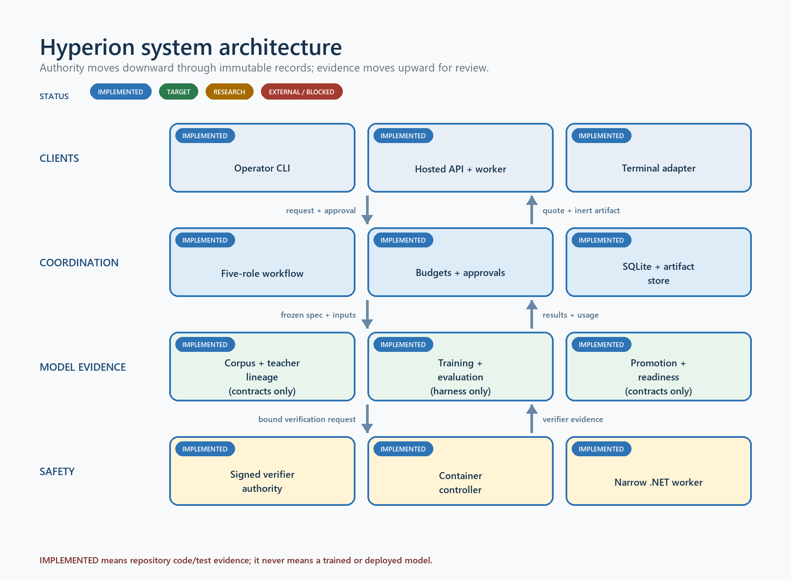
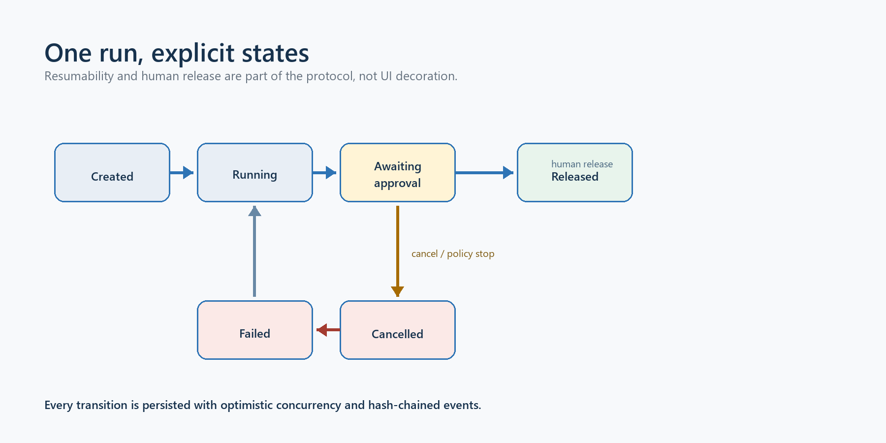
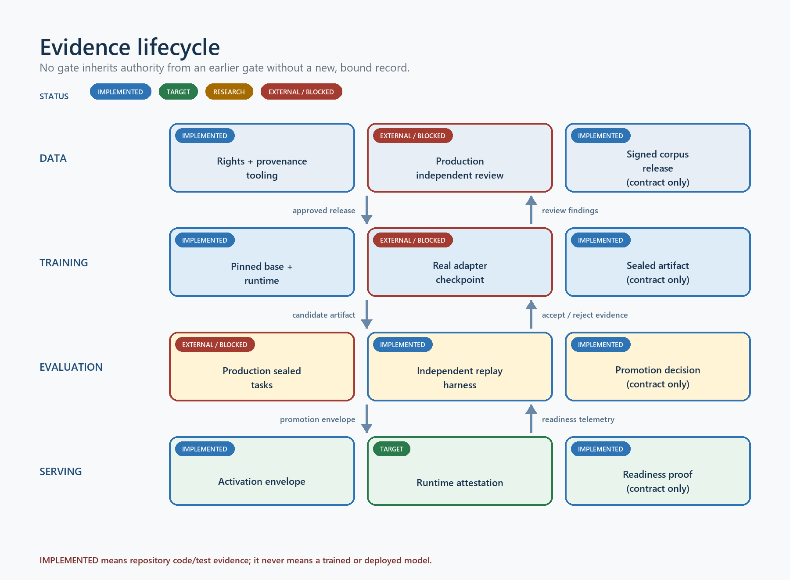
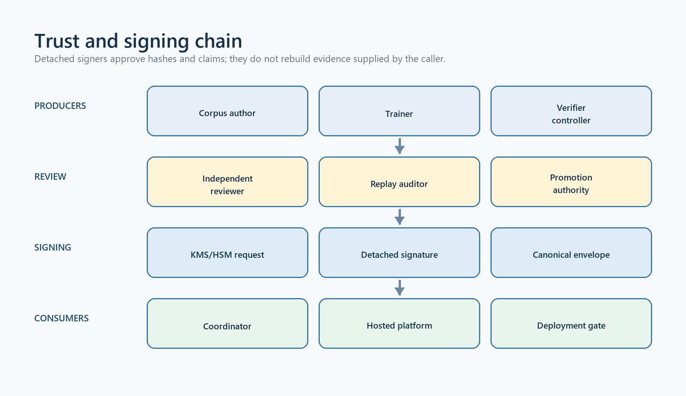
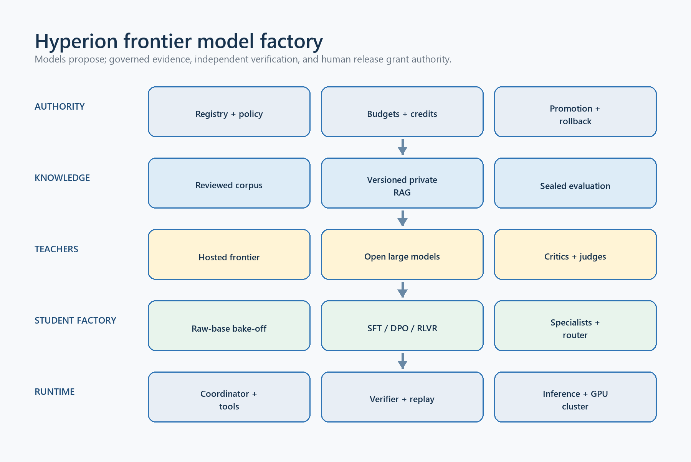
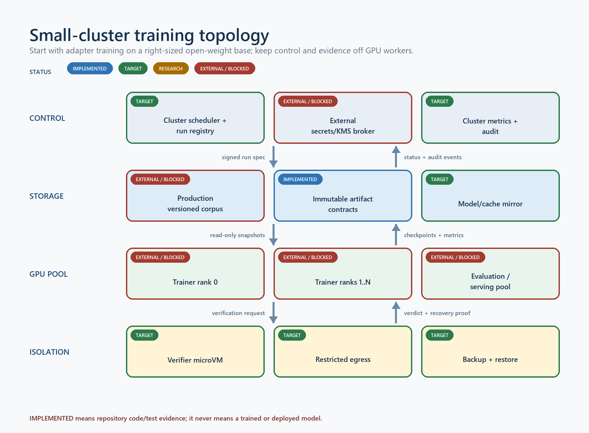

# Hyperion LLM Coordinator

## Engineering handbook for the ML, platform, and safety teams

**Version:** 1.1
**Date:** 31 July 2026
**Classification:** Private engineering material
**Repository:** `dhruuvsharma/Hyperion`
**Audience:** ML engineers, research engineers, platform engineers, security reviewers, and technical operators

Hyperion is the private expert-model coordinator formerly developed under the Vibe Quant name. This
handbook explains the system from first principles: why it exists, how the code is organized, how a
request moves through the coordinator, how data can become training material, how a base model is
selected and tuned, how evidence is evaluated and signed, how a model is activated, what the
isolated verifier can and cannot prove, what Kimi K3 contributes to the research direction, and what
the proposed GPU cluster must provide. The canonical target design is
[`docs/architecture/hyperion-frontier-architecture.md`](../architecture/hyperion-frontier-architecture.md);
this handbook combines that future architecture with the exact implementation evidence engineers
must preserve while building it.

> Evidence boundary: Hyperion has substantial implemented infrastructure and passing tests. It does
> **not** yet have a rights-approved production corpus, a conforming training run, trained Hyperion
> weights, a checkpoint, an accepted benchmark result, or a production deployment. This document
> never treats infrastructure tests as model-quality evidence.



## 1. Executive orientation

### 1.1 The problem Hyperion solves

A general coding model can generate plausible C#, financial reasoning, and strategy code, but
plausibility is not enough for a trading product. The system must know which private architecture is
current, distinguish quantitative truth from confident prose, obey risk and execution boundaries,
produce reviewable artifacts, and preserve an evidence trail. It must also prevent a desktop client
or generated program from deciding its own price, model identity, approval state, or safety result.

Hyperion addresses this as a system, not merely as a fine-tuned model. It combines:

- a deterministic five-role workflow around one or more LLM providers;
- explicit budgets, approvals, persistence, resumability, and content-addressed artifacts;
- a private data path with rights, provenance, contamination, independent review, and signed receipt
  gates;
- raw-base comparison, adapter training, sealed evaluation, and promotion contracts;
- server-owned model, retrieval, credit, and readiness authority;
- independently signed evidence and detached KMS/HSM handoffs; and
- a deliberately narrow C# strategy verifier executed outside the coordinator process.

The model is one replaceable component. The evidence chain is the product boundary.

### 1.2 Three planes

Hyperion is easiest to understand as three interacting planes.

| Plane | Responsibility | Primary implementation |
|---|---|---|
| Coordination plane | Convert an objective and bounded evidence into role outputs, a final inert artifact, and a human release decision. | C# contracts, coordinator, client, CLI, hosted API |
| Model-evidence plane | Govern corpus, teacher capture, base selection, training, evaluation, artifact sealing, promotion, and readiness. | Python package and 113 JSON Schemas |
| Execution-safety plane | Evaluate a small allowed C# strategy surface without loading submitted managed code into the host. | Python controller, signed authority, Docker protocol, .NET verifier worker |

The planes exchange immutable, content-addressed records. A passing record in one plane does not
silently grant authority in another. For example, a verifier result is evidence, not corpus review;
a corpus review is not training authorization; a training artifact is not model promotion; and a
readiness proof is not hardware attestation.

### 1.3 Current status at a glance

| Capability | Status | Meaning |
|---|---|---|
| Five-role coordinator and Mock/OpenAI-compatible providers | Implemented and tested | Runnable orchestration infrastructure |
| Durable SQLite state and hash-chained events | Implemented and tested | Recoverable run state with optimistic concurrency and integrity checks |
| Corpus authoring, review, receipts, releases | Implemented contracts and tooling | No production-approved rows or release currently exist |
| Candidate catalog and raw-base bake-off | Implemented contracts and synthetic tests | No real signed bake-off has selected a base |
| QLoRA training harness and sealed runtime profile | Implemented, not run on target hardware | No trained adapter/checkpoint exists |
| Evaluation, replay audit, promotion, readiness | Implemented contracts and synthetic evidence | No accepted production promotion exists |
| Hosted credits and worker integration | Implemented and tested | Disabled by default without real deployment evidence |
| C# verifier | Implemented and adversarially tested | Narrow strategy subset only; not a general C# sandbox |
| Production KMS/HSM, account/device broker, GPU cluster | External work | Required before production use |

## 2. Naming, compatibility, and provenance

### 2.1 Hyperion is the product name

The repository, solution, operator executable, Python distribution, and new documentation use
**Hyperion**. The initial source was exported from private Pro revision
`003685a92e7ddba9e4149d3bb545f4ce82446f3e`. Shared Core and SDK code is not duplicated; it is the
read-only `public/` submodule pinned at `ae19c5eb7ab7b3c6d6e1a5647fc127a838e6dd05`.

### 2.2 Why legacy names remain

The code still contains `DaxAlgo`, `TradingTerminal`, `VibeQuant`, and `vibe_quant_model`. These are
not accidental branding leftovers when they appear in:

- JSON Schema `$id` or `schemaVersion` values;
- signature domain separators, payload shapes, IDs, and hashes;
- prompt-catalog hashes and policy/workflow versions;
- API routes such as `/api/v1/vibe-quant`;
- database columns, persisted snapshots, golden fixtures, and existing namespaces; or
- downstream client contracts.

Changing one byte can invalidate a signature, fixture, persisted record, replay identity, or client.
Hyperion therefore adds aliases at human-facing surfaces and preserves legacy wire values until a
deliberate versioned migration can dual-read, dual-verify, and retire the older form. A global rename
would be a security and compatibility defect.

### 2.3 What was intentionally excluded

The extraction excludes build caches, ignored `tmp/vibe-quant-model` experiments, local databases,
credentials, private keys, model caches, weights, checkpoints, and draft evidence. Those bytes were
not needed to reproduce the code and were not an authorized training release. The full inventory and
boundary are recorded in `docs/architecture/source-provenance.md`.

## 3. Repository and technology map

| Path | Technology | Role |
|---|---|---|
| `src/windows/AI/TradingTerminal.Ai.Coordinator.Contracts` | .NET 9 | Immutable run, provider, budget, role-output, approval, and artifact contracts |
| `src/windows/AI/TradingTerminal.Ai.Coordinator` | .NET 9, SQLite | Orchestration, validation, providers, persistence, dataset/retrieval tools |
| `src/windows/AI/TradingTerminal.Ai.Coordinator.Client` | .NET 9 HTTP/JSON | Strict hosted API client and wire contracts |
| `src/windows/Tools/DaxAlgo.Coordinator.Cli` | .NET 9 | `hyperion` operator CLI and restricted DAXQ review verifier |
| `tools/hyperion-model/vibe_quant_model` | Python 3.11+ | Model-data, training, evaluation, signing, promotion, and serving logic |
| `tools/hyperion-model/schemas` | JSON Schema 2020-12 | Closed wire contracts for every evidence/authority family |
| `platform/src/DaxAlgo.Platform.Api` | ASP.NET Core, EF Core | Identity, credits, hosted runs, promotion, readiness, worker orchestration |
| `platform/src/DaxAlgo.Platform.VerifierWorker` | .NET, Roslyn | Source/IL policy and bounded replay worker |
| `src/windows/AI/DaxAlgo.Daxq.*` | .NET | Restricted bytecode verification path used by corpus review |
| `public/` | Pinned Git submodule | Shared Core and SDK compile surface used by verifier/compiler |
| `tests/`, `platform/tests/`, Python `tests/` | xUnit, pytest | Contract, integration, adversarial, and cross-language evidence |

The Python import package remains `vibe_quant_model`; the installed commands include `hyperion`,
`hyperion-model`, and the legacy `vibe-quant-model` alias.

## 4. Coordinator runtime from first principles

### 4.1 Inputs

A run begins with a `CoordinatorRunSpec`. It fixes:

- a unique run ID, owner, objective, and creation time;
- bounded context sources with IDs, titles, exact content, optional URI/license, and retrieval time;
- one provider descriptor: provider/model/protocol/endpoint, pricing, credential reference, and
  optional replay identity;
- a `CoordinatorBudget`; and
- exact policy, workflow, prompt-catalog, and purpose identities.

The two purposes are `Research` and `StrategyAuthoring`. Research ends in a decision memo.
Strategy authoring uses a different prompt/policy/workflow tuple and can emit an inert source bundle.
The purpose is part of semantic identity and idempotency; it is not inferred from a UI mode.

### 4.2 Budgets

The default contract caps requests, attempts per role, prompt tokens, output tokens, output tokens per
request, cost, response bytes, artifact bytes, elapsed time, and per-request timeout. It can require
provider-reported usage. Before dispatch, the coordinator reserves the worst-case request budget;
after completion, it records reported usage and reconciles totals. A provider cannot omit mandatory
usage, return an oversized body, or silently overrun the run budget.

Budgets serve four purposes:

1. bound operational and financial exposure;
2. make replay and evaluation conditions comparable;
3. stop pathological retry or overthinking loops; and
4. provide the control surface for future low/high/max reasoning effort.

### 4.3 Fixed role workflow

Every run executes these roles in order:

1. **Planner** — decomposes the objective, defines falsifiable checks, and identifies evidence gaps.
2. **Evidence Analyst** — evaluates supplied evidence and labels uncertainty.
3. **Critic** — challenges leakage, bias, causality, feasibility, assumptions, and missing
   counter-evidence.
4. **Synthesizer** — reconciles the prior outputs into the final memo or inert strategy draft.
5. **Risk Judge** — approves, requests revision, or rejects the result for human review.

Each role sees a deterministic system instruction, role instruction, run objective, bounded source
material, and the exact prior role artifacts it needs. The prompt builder computes a hash before the
provider call. The returned JSON must deserialize into a closed `CoordinatorRoleOutput` with the
expected role, schema, claims, evidence-source IDs, risks, recommendations, and decision. Unknown
fields, wrong role labels, ungrounded source IDs, invalid confidence values, or malformed strategy
artifacts fail validation.

### 4.4 Provider abstraction

`ILlmProvider` is deliberately small: accept a structured request and return either a completion or
a classified failure. Implementations are:

- `DeterministicMockLlmProvider` for reproducible tests and rehearsals;
- `ReplayLlmProvider` for exact captured responses; and
- `OpenAiCompatibleLlmProvider` for bounded HTTP chat-completion transport.

Provider validation rejects unsafe endpoint/configuration combinations and preserves a credential
as a reference, not as persisted run data. Hosted execution constructs the provider server-side;
the desktop cannot choose a private model artifact, retrieval pack, price, or readiness identity.

### 4.5 State machine and approvals



A new run is `AwaitingStartApproval`. Start approval binds the exact specification hash and moves it
to `Ready`. Resume changes it to `Running` and executes the next incomplete role. A retryable failure
can retry within the role attempt limit; a permanent failure or exhausted budget terminates safely.

After the Risk Judge:

- `Approve` moves to `AwaitingReleaseApproval`;
- `Revise` moves to `NeedsRevision`; and
- `Reject` moves to `Rejected`.

Release approval binds the exact final artifact hash, reopens and revalidates the Synthesizer and
Risk Judge artifacts, and only then marks the run `Completed`. Cancellation and explicit rejection
are terminal. An approval is therefore an authenticated statement about exact bytes, not a generic
button click.

### 4.6 Persistence, concurrency, and recovery

`SqliteCoordinatorStore` stores a current snapshot and an append-only event sequence. Every update
uses an expected version inside a transaction; a stale writer receives a concurrency error rather
than overwriting newer state. Events contain their predecessor hash, forming a per-run hash chain.
Reads verify sequence continuity, previous-hash linkage, each event hash, projection version, and
the bound snapshot hash.

An invocation is recorded before transport. If the process dies with an invocation open, resume
closes the interrupted attempt explicitly and decides whether another attempt is allowed. This avoids
pretending an uncertain provider call never happened. Artifacts are written through a
content-addressed store, checked against expected SHA-256, and referenced by relative path, size,
role, kind, schema, and creation time.

### 4.7 Strategy-authoring output

Strategy authoring does not return an executable plugin. The Synthesizer can produce a bounded file
set with exact names and hashes, objective/evidence lineage, and an `inert-source/v1` delivery state.
The Risk Judge reviews that exact artifact. A client may preview it after completion and may import
source only after the exact human release. Compilation, registration, installation, execution,
broker access, and order placement remain separate capabilities and are not granted by the
coordinator.

## 5. Hosted API, credits, and desktop client

### 5.1 Server authority

The hosted Platform owns authentication, Professional entitlement, tenant/run ownership, model and
retrieval configuration, credit accounting, worker claim, cancellation, promotion validation, and
readiness. The client sends the objective and public evidence; it does not send a trusted price,
model hash, corpus path, promotion, or charge result.

### 5.2 Credit lifecycle

Credits are integers in a server-owned wallet and ledger. A quote is derived from the frozen
specification and policy. Start reserves credits atomically. Completion settles actual bounded usage;
terminal failure or valid cancellation refunds the reservation according to the trusted run state.
Idempotency prevents the same purpose/specification from charging twice. Claim-time checks refund a
run whose frozen model activation is retired or invalid while leaving a temporarily unavailable
current activation queued for retry.

### 5.3 API lifecycle

The compatibility route family is `/api/v1/vibe-quant`. The strict client supports:

- read credits;
- create and list runs;
- fetch status and public specification;
- start, cancel, and resume monitoring;
- fetch a bounded artifact; and
- approve release by exact hash.

The stored server execution specification includes the private retrieval selection and internal
activation binding. The public response deliberately omits private `daxctx.*` source content. Replay
uses the frozen stored specification and does not reopen a changed/deleted pack.

### 5.4 Desktop boundary

The extracted Terminal adapter demonstrates quote, explicit start, polling/recovery, exact preview,
release approval, and source-only import. Its bookmark store uses a bounded, connection-bound,
compare-and-swap record with cross-process locking. It prevents a stale process from clearing or
starting from changed state.

Production remote authentication is not solved by this adapter. A full-trust plugin host is not an
acceptable bearer-token or device-signing boundary. Production needs an isolated, user-approved
account/device/session broker. Loopback Mock development does not prove that design.

## 6. Private retrieval

Private DaxAlgo architecture belongs in retrieval, not indiscriminately in model weights. Stable
coding, mathematics, probability, finance, and risk concepts are candidate weight knowledge;
current private APIs, product topology, and changing policies are versioned retrieval knowledge.

An expert context pack is immutable and content addressed. Pack construction verifies source-root
containment, no reparse traversal, byte hashes, rights, cutoff, domain ordering, line coverage,
canonical chunks, and derived pack/index IDs. The in-memory lexical index uses deterministic integer
scoring and ordinal tie-breaking. Selection binds tenant, corpus/version/hash, query, policy, and
ordered chunk hashes, while exposing only citation IDs to the public view.

The Platform prepares the pinned pack once at startup, caches immutable maps, and creates lightweight
tenant activations. A run uses a bounded query derived from its objective/evidence. No compatible
selection produces a privacy-safe request failure, not a fallback to arbitrary files.

## 7. Corpus and data governance

Hyperion treats training data as a governed release, not as a directory of convenient JSONL files.
The governing question is never only “is this answer useful?” It is also: who produced it, from which
exact sources, under which rights, before which cutoff, for which permitted use, with what independent
evidence, and against which withheld material was it checked?



*Reading guide — evidence lifecycle: authored draft → deterministic checks → independent row
decision → signed receipt → SFT export → corpus/evaluation release → corpus admission → training →
trainer provenance → evaluation → promotion. Every arrow must show the authority it does not grant.*

### 7.1 Record model

An expert example carries the following material fields:

- an exact schema version and stable row ID;
- one task kind and one or more domains;
- an ordered chat conversation and its cross-language, length-prefixed SHA-256;
- source assets, provenance, licence declarations, retrieval/availability times, and source hashes;
- lineage identifying `HumanAuthored`, `OpenWeightTeacher`, `HostedTeacher`, or `DerivedRepair`;
- verification evidence, including compile/test facts when the task claims executable code;
- one of the `development`, `calibration`, or `sealed` splits;
- a contamination group, cutoff, review state, and explicit training-selection bit; and
- five independent rights: `MayStore`, `MayEvaluate`, `MayTrain`, `MayUploadToProvider`, and
  `MayRedistribute`.

The eight canonical domains are C#, DaxAlgo architecture, quantitative mathematics, probability and
statistics, risk management, portfolio management, finance and markets, and WPF/UI design. Task kinds
cover general questions, generation, repair, review, architecture, quantitative/statistical reasoning,
risk, portfolio, market analysis, and WPF design. Labels are coverage dimensions, not proof that the
answer is correct. A reviewer must assess the actual content.

### 7.2 Rights and knowledge classes

Rights are conjunctive and purpose specific. Permission to store a source does not imply permission
to train on it; permission to evaluate locally does not imply permission to upload it to a hosted
teacher; and training permission does not imply redistribution permission. The most restrictive
source in a row constrains the row. The exporter re-derives this result from the live source and row
bytes rather than trusting a cached `trainingEligible` flag.

Stable, generally teachable concepts may be candidates for model weights. Current private APIs,
changing product topology, account policy, and customer-specific information are `retrieval-only`.
Retrieval-only rows cannot acquire training rights by changing a label. This distinction limits
memorisation of private implementation details and makes later architecture changes less likely to
leave stale facts in the model.

### 7.3 Splits and leakage controls

The three splits have different authority:

| Split | Purpose | May become training input? |
|---|---|---|
| `development` | Prompt, compiler, verifier, and workflow iteration | Only after all rights, review, receipt, release, and admission gates pass |
| `calibration` | Select thresholds and diagnose evaluator behaviour | No; it must remain outside optimization |
| `sealed` | Final held-out comparison and promotion evidence | No; prompts, answers, rubrics, and hidden assets must remain withheld |

Exact conversation hashes, normalized user turns, contamination families, task/context/verifier
asset hashes, and cutoff rules are checked across the governed corpus. Exact matching is deliberately
conservative and can reject legitimate repeated language. It does not detect semantic paraphrase,
memorisation from an upstream base model, or leakage through an unrecorded human workflow. Those
risks require provenance review, rolling post-cutoff shadow sets, and periodic leakage audits.

### 7.4 Drafting, verification, and human decisions

The draft compiler is fail closed. It accepts bounded contained inputs, canonicalizes records, checks
messages and rights, refuses path traversal/reparse aliases, and publishes atomically without
overwriting an existing artifact. Draft text checks such as exact equality, required/forbidden text,
and assistant hashes prove conformance to an authored checklist; they do not prove subject-matter
truth.

The human-decision compiler requires a complete decision for every exact row and source. It binds the
dataset, verification manifest, freshly re-executed report, evidence inventory, decisions, and
chronology. A row cannot be silently omitted. The independent-review package and editable decision
form are non-authorizing until compiled, revalidated, and followed by the separately authenticated
receipt process.

### 7.5 Receipts, SFT export, releases, and admission

A current review receipt is a low-S ES256/P-256 statement about one exact row and its exact source
corpus and verification-evidence identities. The receipt’s reviewer, role, audience, key ID, validity
window, and permitted authorizations are explicit. Open-weight-teacher rows additionally require a
distinct, valid teacher-lineage admission. Human-authored rows reject an extraneous teacher admission.

SFT export reopens the corpus and receipts, re-derives canonical metadata, rejects expired or
duplicated receipts, and emits only rows that satisfy every gate. A release then binds the corpus,
optional SFT bytes, receipt set and trust, optional teacher-lineage admission, calibration/sealed
tasks, context/rubric/verifier assets, cutoff, lineage, and evaluation-authoring approval. A separate
corpus-quality admission binds that exact release and SFT dataset to reviewer-selected coverage and
anti-inflation thresholds before any non-smoke training run.

None of these hashes or signatures proves that a licence declaration is legally true, a reviewer is
honest, or an answer is correct. They make the exact claim and claimant auditable and substitution
resistant. Legal review, source custody, and technical review remain human responsibilities.

### 7.6 Current corpus status

The originating workspace contained small, ignored draft seeds and calibration material. They were
not copied into this repository because they were not a production-authorized release. Hyperion
currently contains the contracts, validators, tests, and synthetic fixtures needed to build a real
release, but no rights-approved production corpus, authenticated row-receipt set, signed
evaluation-authoring approval, or corpus admission. The first ML milestone is therefore governed data,
not optimizer execution.

## 8. Teacher capture, selection, and materialization

Teacher generation is a data-acquisition workflow with a strict authority ceiling. A fluent answer
from a strong model is only an unreviewed candidate.

### 8.1 One-way source-grounded manifest

The C# compiler derives teacher-generation manifest v2 from a private development draft plus an
explicit capture plan. It reopens the raw draft, candidate catalog, and every source byte; binds their
hashes; removes the terminal reference answer from model-visible messages; rejects that answer from
every emitted string; and preserves storage/evaluation-only rights. It cannot manufacture a teacher
response, review, receipt, release, or training authorization.

The current catalog assigns Qwen3-Coder 30B-A3B Instruct as teacher/fallback and keeps the three
smaller candidates as students. The commit/revision and licence in the catalog are inputs to identity,
not mutable display metadata.

### 8.2 Passive runtime binding and token preflight

Before capture, a passive binding process derives the expected model/template execution identity from
bounded descriptor, catalog, and chat-template bytes. It observes an already-open literal-loopback
vLLM endpoint and records its claimed version, model, root string, and context limit. Capture revalidates
the same binding before tokenization and again after generation.

This is intentionally labelled an unattested observation. The endpoint can lie about loaded weights,
revision, template, executable, image, process owner, GPU, driver, kernel, clock, or egress. Loopback
does not prove isolation. Production-quality capture requires a separately controlled process owner,
immutable weight store, image/runtime evidence, and governed signer.

Every source-grounded prompt is tokenized through the bound endpoint before dispatch. Prompt tokens,
requested completion tokens, context window, request count, and aggregate worst-case totals must fit
the signed/compiled plan. Completion-reported prompt usage must agree with the reservation. This
prevents a “successful” capture whose real prompt was truncated or whose cost envelope was silently
exceeded.

### 8.3 Multi-seed candidate capture

Capture uses positive temperature and several distinct seeds under hard request, token, byte, and
elapsed-time budgets. Each candidate binds task, source snapshot, prompt, model/revision, runtime
binding, seed, sampling parameters, completion usage, and raw response hash. Publication is all or
nothing and no-clobber. Every output remains `unreviewed`, `useForTraining=false`, and
storage/evaluation-only.

Hosted teacher output may be captured only when the provider contract explicitly permits use for
training another model. Customer prompts remain excluded from training by default.

### 8.4 Withheld deny-set and independent selection

An independent custodian builds a hash-only deny-set from exact calibration/sealed tasks, normalized
user turns, contamination families, and context/rubric/verifier assets. Candidate selection rejects:

- an exact authored conversation prefix;
- a normalized user-turn overlap;
- a forbidden contamination-family match;
- any exact withheld task, context, rubric, or verifier asset used as a source; and
- missing, duplicate, out-of-order, or inconsistently bound candidates.

The selector can admit at most one candidate per task and records why. Selection quality is still a
review assertion; hashes protect the chosen bytes but cannot prove the custodian supplied a complete
secret set or that a semantic leak was absent.

### 8.5 Materialization and lineage admission

Materialization creates a self-contained immutable package: canonical draft JSONL, exact manifest,
runtime binding, selected candidate, source snapshots, deny-set identity, selection record, and a
content-addressed materialization record. The package remains unsigned and non-training.

A separate lineage reviewer then revalidates that complete chain against the proposed final corpus
and signs only the stable teacher-derived subjects it accepts. The lineage signer must be distinct
from the row reviewer. Receipt issuance for an `OpenWeightTeacher` row fails without that exact
admission; downstream SFT export and release revalidate both. Hyperion ships this machinery but no
real captured candidate, materialized teacher package, or lineage admission.

## 9. Base-model catalog and bake-off

### 9.1 Current catalog

The frozen catalog is intentionally small enough to evaluate honestly:

| Role | Candidate | Revision | Declared licence |
|---|---|---|---|
| Student | Qwen2.5-Coder 7B Instruct | `c03e6d358207e414f1eca0bb1891e29f1db0e242` | Apache-2.0 |
| Student | Qwen2.5-Coder 14B Instruct | `aedcc2d42b622764e023cf882b6652e646b95671` | Apache-2.0 |
| Student | gpt-oss-20b | `6cee5e81ee83917806bbde320786a8fb61efebee` | Apache-2.0 |
| Teacher/fallback | Qwen3-Coder 30B-A3B Instruct | `b2cff646eb4bb1d68355c01b18ae02e7cf42d120` | Apache-2.0 |

Licence fields are reproducibility inputs, not legal opinions. Before downloading or using weights,
the team must archive and review the exact upstream licence/model card at the pinned revision.

### 9.2 Exact snapshots

`base-model-source-lock.v1.json` enumerates the expected files, sizes, and SHA-256 values for each
student. Snapshot tooling rejects links/reparse components, unknown or missing files, mutable
revisions, unsafe names, and tree drift; it publishes a content-addressed snapshot identity. Training
and later activation reopen the external read-only snapshot and rehash it. The repository does not
contain the multi-gigabyte weight files.

Read-only POSIX mode checks and repeated hashes are an operator contract, not protection from root, a
hostile kernel, or storage/driver substitution. Production needs an immutable model store and a
privileged owner separate from the training/serving child.

### 9.3 Comparable raw-base evidence

Every student is evaluated under one frozen comparison condition: same release, task suites,
baseline, policy family, seeds, context rules, output limits, and verifier inventory. A raw-base
profile binds model/revision, snapshot/source lock, tokenizer/template, engine launch plan, sampling,
and resource policy. Candidate and baseline responses cover the same task set and retain exact
request/completion receipts where the v2 trust path is used.

The bake-off matrix is catalog complete. It rejects a missing or extra student, duplicate row,
teacher/fallback substitution, source-label drift, unequal release/suite/baseline, or policy-family
drift. Non-selected rows may fail—honest evidence must preserve weaker candidates—but the selected
row must pass every gate.

### 9.4 Selection authority

An independent selector signs base-model selection v2 over the complete ordered matrix and the exact
chosen snapshot/profile, rationale, trust tuple, and validity. Training does not accept an informal
“best model” note or pairwise result. It replays the matrix, catalog, source lock, and selected external
snapshot. Selection authorizes only that training input; it is not a checkpoint, model-quality
guarantee, promotion, or deployment.

No real raw-base captures or signed selection exist yet. Adding Kimi K3 to a research list must not
silently change this production catalog or its hashes; any catalog change is a reviewed, versioned
experiment followed by a fresh complete bake-off.

### 9.5 Target challenger and teacher portfolio

The four-entry catalog above is the implemented comparison contract, not the limit of Hyperion's
target architecture. A separate dated registry admits any technically useful hosted, downloadable,
gated, commercial, custom-licensed, or permissioned candidate for research. Access, price, terms,
attribution, retention, and the accountable permission owner are provenance fields; they are not
automatic technical rejection criteria.

| Portfolio tier | Current source-reviewed examples | Intended role |
|---|---|---|
| Hosted frontier | GPT-5.6 Sol/Terra/Luna, Gemini 3.1 Pro, Claude Fable 5, Kimi K3 API | Difficult teacher traces, independent criticism, multimodal and long-context comparison |
| Large open/downloadable | Kimi K3, Qwen3.5 large MoE, GLM-5/5.2, DeepSeek R1/V3 line, Llama 4, gpt-oss-120b, MiniMax-M2.5 | Reproducible teachers, logits when available, large-cluster challengers |
| Small-cluster students | gpt-oss-20b, practical Qwen3/Qwen3-Coder sizes, Qwen3.5-9B, Devstral Small 2 24B, Falcon-H1-34B | Private adapter training and economical serving |
| Specialists | C#/architecture, UI, quant/math, risk/portfolio, research/tool-use adapters at measured effort levels | Domain depth without forcing one checkpoint to dominate every task |
| Control models | Router, critic, judge, embedding model, reranker | Selection, retrieval, uncertainty, and independent challenge |

Every registry record pins the source/revision and records modality, context, disclosed total/active
parameters, architecture, template/tool protocol, precision, runtime, measured resources,
quality/latency/cost evidence, allowed roles, data policy, and lifecycle state. Unknown internals stay
unknown. Adding a record grants no training, promotion, activation, or user-data authority.

## 10. Training system

### 10.1 Frozen software environment

The current training profile requires CPython 3.11 on Linux x86_64/manylinux 2.28 with CUDA 12.1.
Its direct roots are Accelerate 1.2.1, bitsandbytes 0.45.2, cryptography 48.0.0, datasets 3.2.0,
PEFT 0.14.0, PyTorch 2.5.1+cu121, Transformers 4.48.3, and TRL 0.15.2. The PEP 751-style lock is
bound by SHA-256 `9e55bffe81d66a1f85bbacb6f910cac5fc01f0bfff99b4418fa53188784b3e72`.

These versions are a reproducibility baseline, not a permanent security approval. Before a real run,
the team must validate wheel availability, licences, vulnerabilities, driver compatibility, GPU
architecture support, and the exact container image. Upgrading one root requires regenerating the
complete lock and repeating smoke/evaluation evidence.

### 10.2 Non-smoke preconditions

A production-relevant run uses training manifest v3. It requires:

1. a current rights-bearing corpus/evaluation release;
2. valid row receipts and, where applicable, teacher-lineage admission;
3. a signed evaluation-authoring approval;
4. a signed corpus-quality admission over the exact SFT bytes;
5. a signed catalog-complete base selection over the exact external snapshot;
6. the frozen runtime profile and complete dependency lock; and
7. a distinct trainer-provenance trust configuration.

Manifest v1 and selected v2 paths are retained only for explicit smoke scenarios. They cannot be
relabelled as production training evidence.

### 10.3 QLoRA SFT pilot

The near-term method is supervised fine-tuning through QLoRA, not pretraining a new architecture.
The harness validates canonical chat rows, snapshots all inputs before work, records model/dataset/
environment identities, enforces GPU/runtime gates, stages output, and republishes only after final
revalidation. The initial objective is reliable instruction following, bounded DaxAlgo reasoning,
and repair quality—not simulated profitability.

A sensible stop/go sequence is:

1. measure every raw base and strongest baseline on calibration and sealed-policy rehearsal;
2. run a tiny smoke job to validate tokenization, gradients, checkpoint-free safe output, and memory;
3. run one bounded single-seed SFT pilot;
4. compare against raw base and baseline under identical evaluation conditions;
5. repeat promising settings across multiple seeds and report uncertainty; and
6. consider preference optimization or verifier-derived rewards only after SFT plateaus and the
   evaluator has passed reward-hacking and mutation audits.

Do not train directly on sealed answers, hidden verifier cases, customer prompts, private retrieval
facts, unreviewed teacher responses, or failed model outputs. Do not optimize PnL, Sharpe, or backtest
rank as a reward: those objectives are noisy, gameable, and invite overfitting and unsafe risk.

### 10.4 Safe artifact format

The accepted output is a bounded PEFT adapter/inference tree with safe JSON and safetensors. Unknown
files, nested links, custom remote code, pickle-based optimizer/checkpoint state, malformed
safetensors, template drift, and unexpected mappings fail closed. A deterministic tree hash and
artifact core bind the adapter to its base, manifest, run, release, dataset, and environment.

The trainer first creates an unsealed pending tree. A separately custodied signer issues trainer
provenance only after training, because the signature must bind the final bytes. Finalization reopens
the live inputs and pending tree and installs artifact v2 atomically. An unsigned pending tree or
signing bundle is not consumable by evaluation or serving.

### 10.5 Measurements to retain

For every attempt retain configuration, seed, data/release hashes, model snapshot, tokenizer/template,
effective batch and accumulation, sequence-length distribution, optimizer/scheduler, LoRA target
modules/rank/alpha/dropout, precision, gradient clipping, loss curve, evaluation checkpoints, wall and
GPU time, peak memory, power/thermal data, failures, and final tree identity. Record negative and
aborted runs as evidence; deleting them makes selection bias invisible.

Hyperion currently has no conforming training run, adapter, checkpoint, or trained weights.

### 10.6 Target distillation and post-training ladder

QLoRA SFT is the first experiment, not the final architecture. Each later stage starts only when the
previous stage beats the raw base and strongest frozen baseline on sealed primary gates without
protected-domain, safety, latency, or cost regression.

1. **Raw-base plus retrieval bake-off:** compare unmodified candidates with and without the same
   retrieval pack so retrieval gains are not misattributed to training.
2. **Verified SFT:** use reviewed human examples and teacher sequences whose compiler, tests,
   numerical oracle, citations, or risk checks pass. For MoE students such as gpt-oss, tune the
   supported expert projections as well as attention when the upstream recipe requires it.
3. **Preference optimisation:** test DPO first after SFT stability. SimPO, KTO, or another objective
   is a challenger only when its data assumptions match the reviewed preference records.
4. **RL with verifiable rewards:** compare RLOO and GRPO on identical tasks. Reward exact outcomes
   and bounded efficiency; log KL, entropy, group composition, zero-variance groups, response length,
   and each reward component. Never optimise backtest PnL, Sharpe, or public benchmark rank directly.
5. **Multi-teacher/on-policy distillation:** route prompts to teachers that passed domain calibration,
   retain disagreements and provenance, and use student-generated trajectories. Token-level
   distillation requires authorised teacher probabilities or logits; hosted text is not equivalent.
6. **Specialists and routing:** isolate C#/architecture, UI, quant/math, risk/portfolio, and
   research/tool-use adapters at low/high/max effort. Start with rules; accept a learned router only
   after it improves calibration, cost, abstention, and worst-domain quality.
7. **Architecture research:** KDA/DeltaNet, sparse attention, Transformer-Mamba hybrids, Attention
   Residuals, Stable LatentMoE, MTP, early-fusion vision, and Muon variants require controlled
   pretraining ablations. They are not features that QLoRA can retrofit faithfully.

Process reward models may improve long-trajectory credit assignment, but they are auxiliary where an
executable verifier exists. DAPO, asynchronous RL, and large disaggregated rollout stacks are later
pilots after small-scale correctness and reward-hacking audits.

## 11. Evaluation, replay, and promotion

### 11.1 Evaluation layers

Evaluation must separate at least four questions:

| Layer | Question |
|---|---|
| Structural | Did the response obey schema, size, finish reason, and required fields? |
| Deterministic | Do exact-text, JSON-shape/type/value, numeric, compile, or replay checks pass? |
| Comparative | Does the candidate beat the strongest frozen baseline without domain regression? |
| Human/safety | Is the answer correct, useful, risk-aware, and acceptable for release? |

Public benchmarks are useful smoke signals but cannot replace the private C#, SDK, quantitative,
risk, architecture, and UI suite. Maintain immutable calibration and sealed releases plus a rolling
post-cutoff shadow set. Report overall and per-domain acceptance, critical failures, contamination
groups, cost/latency, and confidence intervals across seeds rather than one aggregate score.

### 11.2 Authoring and withholding

The evaluation-suite handoff derives answer-omitting tasks and exact content-addressed context,
rubric, and verifier assets from reviewed source rows. A separate evaluation-authoring signer
authenticates the complete inventory. This signature proves which bytes were approved; it does not
prove the expected values are correct, the suite is representative, or custody was genuinely secret.

Calibration chooses thresholds. Sealed tasks decide promotion. Neither set may appear in teacher
prompts, training messages, preference data, prompt tuning, base selection rationale, or development
feedback. Hidden C# cases stay host side and never enter the verifier container.

### 11.3 Candidate/baseline aggregation

Candidate and baseline must cover the exact same sealed tasks. Aggregation rejects missing or extra
responses, non-stop completions where stop is required, invalid usage, task/profile/seed drift,
critical failures, insufficient suite/domain/contamination coverage, absolute threshold misses, and
overall or per-domain regression. The report remains `unpromoted` even when all gates pass.

Declarative verifiers are freshly replayed from exact bytes. C# rows can be fully replayed offline
and then bound by a separate signed replay audit for later promotion/readiness revalidation without
running Docker in the production control path. A mixed suite still freshly executes every declarative
row and requires the exact C# audit for its covered rows.

### 11.4 Promotion

Promotion is a new independently signed decision. It reconstructs evidence from the live release,
responses, verifier results/audit, policy, selected base, artifact v2 and trainer provenance rather
than trusting a self-consistent report. It binds:

- exact candidate adapter and base snapshot identities;
- corpus, evaluation, receipt, authoring, and trainer authorities;
- candidate/baseline results and thresholds;
- serving/deployment profile, provider/model alias, coordinator/prompt policy, and retrieval pack;
- credit/pricing policy and strategy-authoring capability; and
- approval, environment, issue/expiry, signer, and deployment identities.

Validity is capped by the earliest applicable upstream authority. Selection and corpus-admission
expiry authorize historical training, while receipt, authoring, replay-audit, trainer-provenance, and
promotion lifetimes constrain serving according to their contracts. A production promotion does not
exist until an independent signer issues it over real evidence.

### 11.5 Promotion decision record

The reviewer should publish a compact decision alongside machine evidence: candidate and baseline,
releases, primary/secondary metrics, confidence, known regressions, cost/latency, safety failures,
accepted limitations, rollback target, and approvers. “Tests passed” is never enough. If proper-score
or correctness gains are small, unstable, isolated to one domain, or bought through excessive token
use, keep the model in shadow or reject it.

## 12. Serving, readiness, and hosted operation

### 12.1 Serving profile

A serving profile binds exact base, adapter/artifact tree, manifest, tokenizer, chat template,
quantization, context limit, serving image, hardware class, and endpoint policy. Its hash becomes the
internal execution-model identity. A client receives only a reviewed public profile name and the
safe specification; it does not choose a snapshot, adapter path, endpoint, API key, or price.

### 12.2 Engine-owning wrapper

Engine-wrapper config v7 is the only production-launchable contract. Earlier versions remain
parseable for migration but cannot start service. V7 revalidates the release, signed selection,
external read-only base snapshot, artifact v2/trainer provenance, promotion, evaluation-authoring
trust, optional teacher-lineage trust, and required C# replay audit before launch.

The wrapper verifies a pinned executable/version and orchestrator-asserted image digest, starts one
deterministic literal-loopback vLLM/LoRA child under a distinct identity, uses the exact snapshot for
model and tokenizer, blocks mutable cache/revision lookup, waits for load, and rechecks the model and
adapter identities. Only then may it answer readiness or completion requests. It periodically rehashes
the bounded activation inputs and fails closed on drift.

### 12.3 Readiness and Platform gates

Readiness v2 is a short-lived, nonce-bound HMAC proof over the hidden profile, artifact/tree,
promotion, deployment, endpoint, provider, hosted policy, and expiry. It proves possession of the
configured operational secret and agreement with the wrapper’s software state. It does not prove
loaded GPU tensor values, hardware serials, driver/kernel integrity, TEE state, or honest clocks.

The Platform checks the exact activation before reserving credits, claiming queued work, and every
provider dispatch. A retired or mismatched activation refunds unstarted work; transient loss of the
current activation leaves it queued according to policy. Completed artifacts and release decisions
remain readable without reconstructing a retired model.

### 12.4 Network, secrets, and supervision

Production requires an external authenticated boundary: TLS or mTLS, DNS/egress allowlisting, secret
injection, request/body limits, rate limits, structured redacted logs, metrics, tracing, health and
queue alerts, process supervision, and an incident-tested rollback. Runtime signing has a pinned-TLS
loopback broker seam, but the repository does not supply a deployed broker, credentials, provider
IAM, quorum, audit, rotation, or revocation.

The child receives only its minimum runtime environment. Wrapper, signing, and readiness secrets must
not enter the child process or persisted artifact. Model responses and prompts require explicit
retention policy, encryption, tenant isolation, and deletion/export controls.

### 12.5 Rollout and rollback

Roll out in stages: offline only, shadow traffic, internal users, small allowlisted tenant cohort,
then controlled production. Compare quality, refusal, latency, queue time, GPU memory, token usage,
credits, and failure modes at every stage. Keep the previous signed activation and immutable model
tree available until the new release completes its observation window. Rollback changes the active
signed deployment; it never edits historical evidence.

## 13. C# verifier and execution-security boundary

### 13.1 Intended profile

The verifier evaluates one bounded UTF-8 C# source file implementing one public
`IBacktestStrategy` against the exact frozen `TradingTerminal.Core` and `DaxAlgo.Sdk` assemblies. It
does not accept projects, package restore, source generators, WPF/XAML, full plugins, arbitrary
general-purpose programs, broker connections, live orders, or installation.

Each replay runs in a fresh killable worker process inside a digest-pinned Docker image. Host-only
expectations are never sent to the container. The host derives six ordered checks:

1. `source-binding`;
2. `compile`;
3. `analyzers`;
4. `deterministic-execution`;
5. `reference-cases`; and
6. `sandbox-policy`.

The result binds source, request, expectations, traces/errors, toolchain, image, sandbox, and
authority identities. A pass is evidence for this profile only; it is not permission to compile,
install, execute, trade, review a corpus row, train, or promote.

### 13.2 Source and IL policy

The worker combines a closed source/API surface with post-compilation IL inspection. It rejects
unsafe or unbounded constructs and known escape classes, including direct or transitive forbidden
Core helpers, randomized hashes, continuations, cancellation/progress machinery, `async void`, nested
async state machines, finalizers, and module initializers. Runtime replay uses bounded input, wall
time, process lifetime, output, memory policy, and deterministic duplicate execution.

Static policy reduces attack surface but cannot prove arbitrary semantic safety. Roslyn, the CLR,
the allowed SDK surface, the container runtime, and the host remain trusted computing base. A newly
discovered runtime/compiler bug or allowed-API gadget requires a policy/version change and fresh
authority/evidence.

### 13.3 Signed authority

Verifier authority v2 is an externally signed, at-most-seven-day lease. It fixes the exact repository
digest/config image ID, linux/amd64 platform, absolute entrypoint, worker/runtime/Core/SDK/Roslyn
toolchain, request/result protocols, hardcoded sandbox, absolute Docker client path/hash/size,
explicit local daemon endpoint, and scrubbed Docker configuration/home/temp environment. Ambient
`PATH`, Docker context/configuration, and environment overrides do not select the client or daemon.

The controller privately snapshots the authenticated client, inspects image/container identities,
executes with the signed endpoint, compares the reported toolchain, rechecks client/authority identity
before publication, and emits a content-addressed result. Lease renewal with the same stable
configuration may preserve semantic result identity; runtime/toolchain drift changes it.

### 13.4 Explicit residual limits

These limits must appear in every security review and production decision:

- **Caller-selected image and entrypoint.** The signature authenticates that an external reviewer
  selected those exact values; it does not discover image provenance or prove the entrypoint is
  correct. Supply-chain review and a trusted build/publish pipeline remain external.
- **Unattested Docker seccomp and host runtime.** The controller can bind the declared sandbox and
  inspect configuration, but it does not independently attest the daemon/socket owner, OCI runtime,
  kernel, resolved built-in seccomp implementation, namespaces, cgroups, or host hardware. A
  compromised daemon or privileged host can fabricate evidence.
- **Host path-swap windows.** The client snapshot and output paths are validated and hashed, but a
  privileged or same-user actor can still race narrow validate/open or validate/publish windows.
  Stronger closure requires opened-handle/handle-relative execution, immutable custody, or a
  privileged owner that untrusted users cannot race.
- **No general sandbox claim.** The profile deliberately excludes WPF, packages, multi-file builds,
  arbitrary plugins, and live execution. Passing it cannot be generalized to those surfaces.
- **No reward authority by default.** The verifier currently supplies offline evaluation evidence.
  It is not automatically an RLVR reward or hosted-code execution gate.

For higher-risk autonomous or RL workloads, move beyond an ordinary shared-host container to a
microVM or separate-host sandbox with immutable images, denied egress, strong identity, external
attestation where justified, and an incident-response plan.

## 14. Signing, trust separation, and key custody



*Reading guide — trust chain: distinct row-review, teacher-lineage, evaluation-authoring,
corpus-admission, base-selection, verifier-authority, replay-audit, trainer-provenance, promotion,
launcher-activation, and runtime-receipt signers; show exact inputs, expiry propagation, and denied
downstream authorities.*

### 14.1 What a signature means

Hyperion uses canonical payloads, domain-separated preimages, SHA-256, ES256/P-256, fixed trust
tuples, and low-S signature normalization. A verifier checks exact bytes, payload type, audience,
key ID, signer role, subject/deployment identity, chronology, issue/expiry, public-key SPKI hash, and
authority flags. Unknown fields and noncanonical encodings fail closed.

A valid signature means the holder of the trusted private key signed that exact statement. It does
not prove the real-world identity or honesty of the operator, the truth of a rights declaration,
expected-answer correctness, loaded weights, GPU execution, isolation, or an honest clock.

### 14.2 Separation of duties

The following decisions should use distinct keys and organizational roles:

| Authority | Decision |
|---|---|
| Row review receipt | This exact row/evidence is approved for the declared uses |
| Teacher-lineage admission | This exact teacher chain maps to these exact reviewed rows |
| Evaluation authoring | This exact task/rubric/verifier inventory was independently authored |
| Corpus-quality admission | This exact SFT release meets reviewer-chosen coverage thresholds |
| Base selection | This catalog-complete matrix selects this exact base snapshot |
| Verifier authority | This exact verifier image/toolchain/sandbox may execute offline |
| Replay audit | This exact full C# replay covers these candidate/baseline rows |
| Trainer provenance | This exact artifact tree came from this exact governed training input/run |
| Promotion | This exact model/evidence/deployment is approved for the stated capability |
| Launcher/runtime | This exact process activation or response was observed under its protocol |

Do not reuse one “ML signing key” for convenience. Separation limits the damage of compromise and
prevents an author from approving their own corpus, evaluator, training output, and deployment.

### 14.3 Detached prepare/sign/finalize

Current authority families expose provider-neutral handoffs:

1. **Prepare** revalidates live inputs and emits an unsigned, content-addressed bundle containing the
   exact payload/envelope fields, trust tuple, raw signature preimage, and digest.
2. An external KMS/HSM or controlled signer signs either the raw message or explicitly supported
   prehashed digest.
3. **Finalize** verifies DER or fixed P1363 input, rejects double hashing/wrong keys/malformed values,
   normalizes valid high-S input, reopens every live binding, and atomically publishes the unchanged
   consumer wire format.

The unsigned bundle grants no authority. A matching bundle/signature pair is nevertheless sensitive
finalization-equivalent material until expiry and must be protected from replay or substitution.

### 14.4 Production custody still required

The repository supplies protocols, not a production KMS/HSM deployment. Before release, define key
owners, IAM, multi-person/quorum approval, environments, audit retention, rotation, revocation,
emergency disablement, backup/recovery, clock source, certificate/public-key distribution, and
incident procedures. Test expired, revoked, wrong-role, wrong-audience, replaced-key, and compromised
signer scenarios. Configuration removal/restart is not a complete long-term revocation service.

## 15. Frontier model architecture and Kimi K3 adoption



Hyperion's target is a governed portfolio rather than a single winner: hosted frontier teachers,
large downloadable teachers, small-cluster students, domain/effort adapters, critics, judges,
routers, embeddings, and rerankers all sit behind one evidence protocol. Kimi K3 is an important
source of architecture and agent-training ideas inside that portfolio, not the only design input.

### 15.1 Verified source and scale

The reviewed primary source is Kimi Team, “Kimi K3: Open Frontier Intelligence,” arXiv:2607.24653v1,
submitted 27 July 2026. The reviewed official report was pinned to MoonshotAI/Kimi-K3 commit
`7c5be9599120d7993748de66a76128614f15f210`; the 47-page PDF hash recorded by the research review is
`936a7a3b655947b014ba96b8a790c3cdb6ea8b37eea514e4b7b52655e20af0f8`.

Moonshot reports a native multimodal mixture-of-experts model with 2.78 trillion total parameters,
104.2 billion activated per token, 93 layers, and a 1,048,576-token maximum context. The architecture
uses 69 Kimi Delta Attention and 24 Gated MLA layers; Stable LatentMoE has 896 routed experts, selects
16 per token, and adds two shared experts. A 401-million-parameter MoonViT-V2 encoder supplies vision.
The reviewed public weight snapshot was approximately 1.42 TiB across 96 safetensor shards before
runtime overhead.

The paper attributes an approximately 2.5× aggregate scaling-efficiency gain over Kimi K2 to the
combined architecture, data, optimizer, and systems recipe. Hyperion must not repeat that figure as
an expected local gain: the report does not isolate one component, and Hyperion’s model size, data,
hardware, objective, and fine-tuning method differ fundamentally.

### 15.2 Post-training lessons

The reported K3 sequence is verified human-annotated agent-trajectory SFT, reinforcement learning for
three broad domains at low/high/maximum reasoning effort to produce nine specialist teachers, and
Multi-Teacher On-Policy Distillation to consolidate them. The report also emphasizes independent and
hidden verification, bounded submissions, diverse scaffolds, resumable long-running sandboxes,
dynamic queue/KV-cache throttling, and separate budgets for workload classes.

These are system lessons, not a recipe Hyperion has reproduced.

### 15.3 Adopt now

| K3 lesson | Hyperion action now | Required evidence |
|---|---|---|
| Effort-conditioned specialists | Add explicit low/high/max effort and token/time/cost budgets; begin with routed adapters over one base | Per-effort quality/cost/latency curves and no cross-domain regression |
| Independent hidden verification | Preserve withheld cases, submission limits, mutation testing, and separate evaluator ownership | Reward-hacking audit and hidden-case stability |
| Diverse agent scaffolds | Vary prompt shells, context policy, tool schema, memory, and subagent availability while recording exact harness/seed | Cross-harness generalization rather than one-scaffold success |
| Partial/resumable rollouts | Persist policy, sandbox/context state, budget, harness, verifier, and staleness window | Deterministic resume and off-policy stability tests |
| Dynamic scheduling | Partition short inference, long context, rollout, training, and evaluation queues using live memory/KV/queue signals | Load tests proving fairness and bounded starvation |
| Progressive context | Extend context only after shorter-context quality is stable and distant evidence is necessary | Length-stratified quality, memory, latency, and short-context non-regression |
| Structured transcripts | Separate roles, visible answers, tool calls/results, scope, and provider state; avoid retaining hidden reasoning | Round-trip/provider tests and privacy review |
| Stronger sandboxing | Plan microVM/separate-host execution for adversarial agent/RL workloads | Threat model, provenance, egress, attestation, and incident exercises |

### 15.4 Pretraining research tracks

Kimi Delta Attention, Attention Residuals, Stable LatentMoE, Quantile Balancing, SiTU-GLU, per-head
Muon, MoonEP, and deployment-wide MXFP quantization are architecture/pretraining-system changes. They
cannot be faithfully added to Qwen or gpt-oss with QLoRA. Test them only in small ablation models
after the dense/adapted baseline, evaluator, and cluster telemetry are trustworthy.

Faithful on-policy distillation requires teacher token probabilities or logits. Hosted text samples
support verified sequence-level SFT, not the per-token K3 objective. Multi-teacher consolidation is
therefore research-only until specialist adapters each pass frozen gates and a reproducible
probability/logit pipeline is available.

Kimi K3 itself is not a practical base for the proposed small cluster. A 1.42 TiB compressed weight
snapshot excludes activations, KV cache, optimizer/training state, redundancy, and service overhead.
Hyperion should apply K3’s governance, budgeting, scheduling, verification, and experiment-design
ideas to the smaller reviewed bases already in its catalog.

### 15.5 Permission-managed access and reproducibility

Kimi K3's custom licence, any paid or gated model, and any separately negotiated research/service
access are acquisition records rather than architecture exclusions. The accountable user or
delegated operator owns account, payment, permission, attribution, renewal, and contractual review.
The registry preserves the exact source/revision, acquired bytes, price/terms snapshot, permission
owner, data-retention policy, and allowed Hyperion roles so experiments remain reproducible and can
be revoked or replaced. A technically superior candidate stays eligible when required permission has
been obtained.

Hyperion still does not bypass access controls, copy undisclosed private material, or infer closed
architecture details from benchmark scores. Kimi K3's report does not publish the complete
pretraining/RL corpora, total tokens/FLOPs, full GPU schedule, or a reproducible end-to-end recipe;
all performance and architecture claims remain source claims until independently reproduced. No
Kimi code, weights, training data, prompt traces, or outputs were copied by this architecture review.

### 15.6 Cross-family architecture decisions

The source review includes GPT-5.6, gpt-oss, Kimi K3, Qwen3/Qwen3-Coder/Qwen3.5, DeepSeek V3/R1,
GLM-5/5.2, Llama 4, Gemini 3.1 Pro, Claude Fable 5, MiniMax-M2.5, Devstral Small 2, and Falcon-H1.
Closed models expose useful service capabilities but not reproducible internals. Open/downloadable
models can be exact local teachers or students after snapshot/runtime validation.

| Mechanism | Target use | Adoption gate |
|---|---|---|
| Dense decoder | Simplest student/training/serving baseline | Keep one dense baseline in every bake-off |
| Sparse MoE | More capacity per active FLOP | Existing active-sparse bases first; measure routing, expert use, all-to-all, quality per joule |
| GQA/MLA/latent KV | Lower KV memory and long-context cost | Upstream-supported implementation plus memory/latency/quality curves |
| Sparse attention/IndexShare | Lower very-long-context compute | Research until implementation and length-stratified evidence are reproducible |
| DeltaNet/KDA or Transformer-Mamba hybrid | Linear/recurrent long-context path with selective attention | Equal-compute small pretraining or Falcon-H1 challenger evaluation |
| MTP/speculative heads | Extra training signal and faster decoding opportunity | Exact runtime support, acceptance, output parity, and tail-latency proof |
| Native multimodality | UI screenshots, charts, PDFs, and repository reasoning | Hosted/large teacher first; sealed modality/privacy tests before student training |
| FP8/MXFP4/MXFP8/QAT | Lower training/serving memory and cost | Separate promoted artifact with verifier parity and rollback |

Reported million-token or multi-million-token windows are capacity claims, not proof that a model
uses distant evidence correctly. Hyperion extends context only after shorter tasks are stable and
tests retrieval dependency, recall position, distractors, memory, latency, and short-context
non-regression.

### 15.7 Target coordinator and agent runtime

The implemented five-role workflow remains the safe baseline. The target runtime permits a bounded
typed graph of planner, retriever/researcher, architect or quant analyst, coder/UI specialist,
executor/tester, critic, risk judge, synthesizer, and human releaser. The deterministic controller—not
the model—owns role schemas, graph width/depth, requests, tokens, tools, elapsed time, cost, artifacts,
retry limits, approvals, and terminal states.

Every trajectory event binds observation, role, model/adapter/effort, prompt or state hash, visible
response, tool call/result, environment and verifier revisions, latency, tokens/cost, and terminal
outcome. The controller can resume an explicit interrupted state and can run independent specialists
in parallel, but a model cannot invent a role, tool, endpoint, credential, permission, or budget.

Routing considers domain, difficulty, modality, context, tool need, data/privacy class, latency,
credit budget, calibrated model quality, availability, and live queue/KV pressure. It freezes model,
adapter, effort, sampling, retrieval, and fallback before charging. Low confidence or high risk routes
to a stronger independent model or human review; it never routes around policy or readiness.

### 15.8 Evaluation and promotion scorecard

The target scorecard combines compile/test/numeric/risk correctness; source grounding; mutation and
scaffold robustness; uncertainty calibration and abstention; tool schema/state/recovery; forbidden
capability attempts; latency percentiles; tokens/tool calls; GPU seconds, energy and memory; credit
cost; and human review burden. Report pass@1 and pass@k plus paired uncertainty. Public SWE-bench,
LiveCodeBench, IFEval, HELM, tau-bench, ToolSandbox, WebArena, and OSWorld lanes are diagnostic;
promotion uses a sealed Hyperion-domain suite with exact prompt, tool, environment, budget, sampling,
and verifier identities.

One candidate must beat the raw base and strongest promoted baseline on predeclared primary gates,
stay within non-inferiority margins on every protected domain, survive contamination and
reward-hacking audit, satisfy efficiency/capacity budgets, and pass independent replay plus human
review. Activation binds the exact model, adapter, quantization, tokenizer/template, engine, image,
arguments, policy, retrieval release, and report. Vendor benchmark tables never substitute for this.

### 15.9 Target inference fabric

Use an engine-neutral gateway with vLLM as the first self-hosted baseline, SGLang as the
prefix/cache/structured-agent challenger, TensorRT-LLM after an NVIDIA model and quantization profile
stabilises, and llama.cpp/CPU as an optional development or edge lane. Pin images, commits, model
revisions, templates, arguments, and quantized artifacts.

Continuous batching, chunked prefill, structured decoding, tenant-safe prefix/KV caches, streaming,
cancellation, overload, and canary/rollback are gateway responsibilities. Benchmark speculative
decoding, Medusa/EAGLE, disaggregated prefill/decode, AWQ/GPTQ/SmoothQuant, FP8, or MXFP only on real
Hyperion traffic; require output/verifier parity, acceptance, memory, throughput, and tail-latency
evidence. Unsupported provider fields fail closed rather than silently changing semantics.

## 16. Proposed small-GPU-cluster architecture



*Reading guide — management/control node; immutable data/model store; two or more isolated GPU
workers; separate evaluation/serving and verifier-sandbox pools; scheduler/queue; telemetry; external
KMS/HSM; denied-by-default egress; backup and artifact registry. Show trust boundaries and which links
carry prompts, weights, evidence, and signatures.*

### 16.1 Design principle

Use scale-out experiments before fragile cross-node model parallelism. A small cluster usually gains
more reliable evidence by assigning one complete QLoRA run, evaluation shard, or inference server to
one sufficiently large GPU/node and running seeds/candidates in parallel. Tensor/expert parallelism
across consumer GPUs and weak Ethernet adds communication, failure, and reproducibility complexity.
Use it only when measurements show a model cannot fit and the interconnect can sustain it.

### 16.2 Logical roles

| Role | Minimum responsibility |
|---|---|
| Control node | Git/registry mirror, scheduler, job manifests, audit DB, immutable artifact index, monitoring; no untrusted model execution |
| Training workers | Homogeneous pinned driver/CUDA/container stack, local encrypted NVMe staging, no default internet, one job identity at a time |
| Evaluation/serving workers | Frozen vLLM profiles, queue/KV telemetry, no training write access, separate activation identity |
| Verifier pool | Separate host or microVM-capable workers; no model/corpus secrets; hidden expectations remain on trusted controller |
| Storage | Versioned read-only base snapshots, governed releases, pending/sealed artifacts, logs, backups, object lock where appropriate |
| External signer | KMS/HSM or isolated signing service; private keys never mounted on model workers |

For early 7B/14B QLoRA, prioritize GPUs with enough VRAM to run one job without multi-node sharding.
Practical memory depends on sequence length, attention implementation, batch/accumulation, optimizer,
LoRA targets, activation checkpointing, and quantization—not parameter count alone. Treat 24 GB as an
engineering floor for useful pilots, prefer 48 GB-class capacity for longer 14B work, and validate
20B/long-context requirements empirically before purchasing. These are planning heuristics, not
fit guarantees.

### 16.3 Interconnect, storage, and power

- Use 10 GbE only for management, model/data distribution, artifact collection, and independent
  single-node jobs; it is not a distributed-training fabric.
- Require measured 25 GbE or faster for any cross-node collective, and prefer qualified 100
  GbE/RDMA for Tier C or sustained model/expert parallel work. Enable RDMA/RoCE/InfiniBand only
  after fabric, MTU, congestion, isolation, and failure tests; prove NVLink benefits on the chosen
  stack.
- Keep pinned weight snapshots in central immutable storage and stage a verified read-only copy to
  local NVMe. Never train from a mutable Hugging Face cache.
- Size local storage for base snapshot, quantized working copy, dataset snapshots, temporary outputs,
  logs, and at least one failed run. Keep checkpoints disabled unless a reviewed safe/resume format is
  introduced.
- Budget sustained power, cooling, rack/circuit headroom, UPS shutdown, thermal throttling, and
  replacement capacity. Record actual GPU clocks, power, temperature, ECC/Xid errors, and throttling.

### 16.4 Cluster bootstrap gate

Before model work:

1. inventory GPU model/serial/VRAM, CPU, RAM, NVMe, NIC, firmware, BIOS, driver, CUDA, and kernel;
2. burn in every GPU and memory path under sustained load; fail on Xid/ECC/thermal instability;
3. pin and hash the OS/container/runtime/driver matrix and synchronize trusted time;
4. configure least-privilege service identities, firewall, denied-by-default egress, secret delivery,
   encrypted storage, and centralized audit logs;
5. validate immutable snapshot copy/rehash and artifact no-clobber publication;
6. run deterministic single-GPU smoke jobs twice and compare manifests/artifact identities;
7. test queue cancellation, worker loss, disk-full, network partition, thermal alarm, signer outage,
   and restore from backup; and
8. measure throughput, peak memory, power, upload/download, and queue latency before scheduling the
   base bake-off.

### 16.5 Scheduling and isolation

Create separate queues and quotas for interactive inference, long-context inference, teacher capture,
training, sealed evaluation, and verifier execution. Admission should consider free VRAM, active
requests, KV cache, local disk, power/thermal state, and expected duration. A long rollout must not
starve a release verifier or production request. Preemption is acceptable only at declared safe
boundaries with an exact resumable state contract.

Training workers should not hold promotion, review, or deployment keys. Evaluation workers should
not write the training corpus. Verifier workers should not receive sealed expected answers or model
weights. Control-plane compromise remains high impact; protect it with MFA, patching, backups,
restricted administration, and auditable change control.

### 16.6 Compute tiers and distributed stack

| Tier | Workload | Default approach |
|---|---|---|
| A: one or two GPUs | 4B-14B dense and roughly 20B active-sparse QLoRA/SFT, evaluation, development serving | Single-node first; avoid sharding when the job fits |
| B: four to eight homogeneous GPUs | 24B-70B adapters, longer context, parallel seeds, verifiable-RL rollouts | Slurm plus PyTorch FSDP/TorchTitan; add ZeRO only when measurements justify it |
| C: multi-node fast fabric | 100B+ models, larger full tuning, MoE/expert parallelism, architecture pretraining | Megatron/DeepSpeed/context/expert parallel after full topology qualification |

Use one scheduler for one GPU pool. Slurm is the first dedicated-cluster profile. Kubernetes with
Volcano/Kueue and the NVIDIA GPU Operator is an alternative when multi-tenancy and always-on services
justify its operational cost, not a second scheduler competing for the same devices. TRL is the
first post-training implementation; veRL, OpenRLHF, NeMo RL, and Ray enter when rollout/training
throughput—not algorithm correctness—is the measured bottleneck.

Inventory `nvidia-smi topo -m`, run CUDA peer-to-peer checks and `nccl-tests`, and retain the
bandwidth/latency matrix. Keep tensor/expert parallel groups inside fast NVLink domains and prefer
data or pipeline parallelism across slower links. RDMA/RoCE/InfiniBand is accepted only after fabric,
MTU, congestion, isolation, and fault tests. Actual fit must be measured from precision, total and
active weights, sequence length, activations, optimizer, attention kernel, batch/accumulation,
checkpointing, KV cache, and runtime—not from a parameter-count label.

## 17. Engineering workflow and operator runbooks

### 17.1 How Hyperion was built

The implementation followed a contract-first, fail-closed sequence. Each stage first defined a
closed wire schema and authority ceiling, then a validator/producer, adversarial tests, cross-language
golden vectors where needed, and documentation of what the result could not prove. Synthetic fixtures
were used to exercise contracts without pretending a real reviewer, key, corpus, GPU run, model, or
deployment existed. This distinction must continue.

### 17.2 Team ownership

| Team/role | Owns | Must not self-approve |
|---|---|---|
| Data steward/legal | Sources, licences, rights, retention, provider-upload permission | Model-quality or technical correctness alone |
| Domain reviewers | Row correctness, risk, architecture, finance/quant evidence | Their own authored material without independent review |
| ML engineers | Tokenization, data transforms, training, experiment records | Corpus rights, sealed evaluator, or promotion |
| Evaluation team | Calibration/sealed suites, hidden cases, baselines, statistics | Candidate training or prompt tuning on sealed data |
| Platform/SRE | Serving, queue, credits, telemetry, rollback | Model-quality acceptance |
| Security/release | Key policy, verifier authority, replay audit, promotion | Content they authored without separation |

### 17.3 New-developer bootstrap

From a trusted clone:

```powershell
git submodule update --init --recursive
dotnet build Hyperion.slnx
dotnet test tests/TradingTerminal.Tests.Pro.Headless/TradingTerminal.Tests.Pro.Headless.csproj
dotnet test platform/tests/DaxAlgo.Platform.VerifierWorker.Tests/DaxAlgo.Platform.VerifierWorker.Tests.csproj
Push-Location tools/hyperion-model
python -m pip install -e ".[auth,promote]" pytest ruff jsonschema
python -m pytest tests
Pop-Location
hyperion --help
```

Use the `[train]` extra only in the pinned Linux/CUDA training environment. Never install mutable
latest ML dependencies into an evidence-producing worker.

### 17.4 Corpus-row runbook

1. Register exact source bytes, provenance, licence, cutoff, and five rights.
2. Author a development row with correct task/domain/knowledge-class labels.
3. Compile the draft; fix validation rather than editing generated output.
4. Run deterministic and supported executable checks.
5. Package exact row/source/evidence for an independent reviewer.
6. Compile complete row/source decisions and reapply review to fresh bytes.
7. Obtain detached signed row receipts; add independent teacher-lineage admission where required.
8. Export SFT and verify coverage/contamination.
9. Build and independently sign the evaluation-authoring/release inventory.
10. Obtain separate corpus-quality admission before non-smoke training.

At every step preserve previous artifacts and IDs. Never “repair” a signed artifact in place; create a
new version and repeat downstream gates.

### 17.5 Teacher runbook

1. Confirm the user-designated permission owner has recorded authorised acquisition/use, current
   terms, attribution, data handling, and expiry for the provider or weights.
2. Freeze teacher revision, tokenizer/template, runtime descriptor, and capture budget.
3. Start the controlled loopback engine and create/revalidate its passive binding.
4. Compile manifest v2 from source-grounded development rows; confirm references are absent.
5. Run live token/context preflight, then bounded multi-seed capture.
6. Have the independent custodian generate the withheld deny-set.
7. Select at most one candidate per task and materialize the immutable package.
8. Perform subject-matter review; issue separate lineage admission and row receipts.

Failure, timeout, disagreement, overlap, or unverifiable runtime state leaves the candidate
unreviewed. There is no “best effort” promotion into SFT.

### 17.6 Base selection and training runbook

1. Acquire every student snapshot at its pinned revision and verify the source lock/tree.
2. Create equivalent raw-base profiles and run the complete catalog matrix against the frozen
   release/suites/baseline.
3. Aggregate gates and obtain independent selection v2 over the exact winning snapshot.
4. Validate the full Linux/CUDA lock and hardware; execute a smoke run.
5. Prepare manifest v3 from signed release, corpus admission, and selection.
6. Run the bounded QLoRA pilot; retain telemetry and negative results.
7. Produce the pending safe adapter tree; obtain external trainer-provenance signature; finalize
   artifact v2.
8. Evaluate without changing prompts, thresholds, or sealed tasks. A failed gate returns to a new
   experiment, not an edited report.

### 17.7 Promotion and deployment runbook

1. Re-run complete candidate/baseline aggregation from exact bytes.
2. Fully replay C# rows and obtain the distinct replay-audit signature.
3. Review quality, regressions, cost/latency, safety, the permission/provenance record, and
   operational capacity.
4. Issue a signed promotion with exact capability and expiry; do not reuse a research-only policy for
   strategy authoring.
5. Prepare engine-wrapper v7 with immutable base/adapter/image and all trust roots.
6. Launch under the distinct service identity; verify post-load model/adapter and readiness v2.
7. Exercise Platform credit/run flow in shadow mode, then stage the rollout.
8. Monitor and retain the rollback activation. Any drift, revoked authority, or critical regression
   disables new dispatch and invokes the incident plan.

### 17.8 Incident runbook

For suspected data leak, key compromise, model substitution, verifier escape, corrupted evidence, or
unsafe output: stop new dispatch; preserve logs/artifacts; revoke/remove affected trust and activation;
isolate workers; record exact times and identities; notify security/data/legal owners; assess every
downstream artifact signed by the affected key/input; rotate and redistribute trust; restore from
known immutable state; rerun evidence; and document the decision to resume or retire. Never delete
evidence to make the system appear clean.

## 18. Testing and continuous integration

### 18.1 Required CI lanes

| Lane | Required checks |
|---|---|
| Source hygiene | UTF-8/newline policy, whitespace, generated/cache exclusion, secret/private-key scan, licence/source manifest |
| .NET coordinator | Build named projects, focused xUnit suites, strict client/contract tests, `dotnet format --verify-no-changes` |
| Platform | Build `platform/DaxAlgo.Platform.slnx`, API tests, credits/idempotency/readiness/promotion cases |
| Verifier | VerifierWorker tests, format, source/IL adversarial mutations, Docker build/replay when runner supports it |
| Python | pytest, Ruff check and format check, compileall, stdlib-only CLI import where expected |
| Schemas | Draft 2020-12 meta-validation, every local `$ref`, generated positive instances, adversarial unknown/missing/mutated fields |
| Cross-language | Conversation/SFT hashes, canonical JSON, public-key/signature vectors, promotion fixtures, prompt-catalog hashes |
| Boundary | Public/private scan, submodule pin, project-reference graph, no model weights/checkpoints/private keys |

The originating verifier closure passed 43/43 tests. The model-tool history records large green
Python/schema/CLI closures, but Hyperion must establish its own clean baseline after extraction; do
not quote an old count as current until the exact commit reruns it.

### 18.2 Test taxonomy

- **Unit:** canonicalization, validation, state transitions, IDs, budgets, and math.
- **Contract:** schema/wire compatibility, strict unknown-field rejection, signatures, versioning.
- **Integration:** SQLite/EF transactions, HTTP client/API, credits, provider adapters, process owner.
- **Adversarial:** substitution, replay, expiry, high-S/malformed signatures, links/path races,
  oversized input, crash/recovery, prompt injection, compiler/IL escapes, daemon/environment drift.
- **Golden:** cross-language hashes and signed synthetic fixtures; update only through reviewed
  version changes.
- **Hardware:** runtime lock, deterministic smoke, peak memory, thermal/fault behaviour, throughput.
- **Model quality:** frozen candidate/baseline suites and human review; never conflated with software
  unit tests.

### 18.3 Evidence discipline in CI

CI keys and fixtures must be explicitly synthetic and incapable of production authorization. CI may
prove that a signer protocol rejects tampering; it must not issue a production receipt, selection,
promotion, or activation. GPU CI should run only on controlled workers with pinned images and empty
mutable caches. Logs must redact prompts, source bodies, bearer tokens, private paths, and secrets
while retaining safe content hashes and correlation IDs.

### 18.4 Change rules

Any change to a schema constant, domain separator, canonicalization, prompt text/hash, catalog,
source lock, verifier policy, runtime lock, or authority ceiling is a compatibility/security change.
It requires targeted adversarial tests, regenerated golden vectors, migration/rollback notes, and
review by the owning security/data/evaluation role. Human-facing Hyperion branding must not mutate
legacy wire identities accidentally.

## 19. Roadmap and release gates

| Phase | Work | Exit gate |
|---|---|---|
| 0. Repository baseline | Re-run all extracted .NET/Python/schema/format/boundary checks; establish CI and owners | Green reproducible commit; no secrets/weights; documented provenance |
| 1. Governed corpus | Expand permission-recorded rows, independent correctness/source decisions, receipts, teacher lineage where used, evaluation authoring | Signed release plus corpus admission; meaningful domain/task coverage; no sealed leakage |
| 2. Cluster and custody | Build/burn in workers, immutable storage, denied egress, telemetry, external signers and revocation | Repeated deterministic smoke; incident/restore/key-rotation exercises pass |
| 3. Raw-base bake-off | Run the production catalog plus retrieval/no-retrieval comparisons; evaluate registry challengers separately | Signed selection v2 over complete production matrix and exact snapshot |
| 4. Expert-student pilot | Run bounded verified SFT, then DPO only if SFT passes; seal safe artifacts and compare multiple seeds | Reproducible improvement over raw base and strongest baseline without protected-domain regression |
| 5. Verifiable reasoning | Compare RLOO/GRPO on compiler/test/math/risk rewards; train isolated domain/effort adapters and router | Reward-hacking audit, specialist gates, calibrated routing, and bounded efficiency all pass |
| 6. Evaluation/promotion | Full sealed aggregation, C# replay audit, human/safety/cost review | Independent signed promotion with rollback target and bounded capability |
| 7. Serving rollout | Engine-wrapper v7, vLLM/SGLang comparison, readiness, remote auth, credits, staged shadow/cohort deployment | Stable SLOs, reconciliation, security sign-off, rollback drill |
| 8. Multi-teacher scale-out | Domain-calibrated teachers, on-policy distillation where probabilities/logits are authorised, persistent agent rollouts | Beats sequence-SFT and routed specialists under identical sealed conditions |
| 9. Architecture research | Equal-compute KDA/DeltaNet, sparse-attention, Mamba-hybrid, MTP, MoE, multimodal and quantisation ablations | Each mechanism independently beats the simpler accepted baseline before scale-up |

Stop rather than advance when the required access/permission owner has not supplied an authoritative
source and permission record, sealed custody is compromised, signer separation is unavailable, the
runtime/snapshot drifts, the evaluator is gameable, critical failures appear, gains vanish across
seeds, cost/latency exceeds policy, or rollback cannot be demonstrated. More infrastructure cannot
substitute for missing real evidence.

The first legitimate “trained Hyperion” milestone requires, at minimum: governed SFT bytes; signed
base selection and corpus admission; a conforming GPU run; finalized artifact v2 with trainer
provenance; and measured candidate/baseline results. The first “production Hyperion” milestone also
requires signed promotion, wrapper/readiness activation, production authentication/key custody,
operational SLO evidence, and a staged rollback-tested deployment.

## 20. Limitations and non-goals

### 20.1 Current limitations

- No rights-approved production corpus, real authenticated receipt release, signed base selection,
  training run, adapter, checkpoint, benchmark win, promotion, or production deployment exists.
- Current catalog and runtime pins are starting hypotheses. Hardware, licence, vulnerability,
  performance, and model-quality reviews remain outstanding.
- The hosted Platform is a substantial development foundation, not proof of production identity,
  multi-instance durability, object storage, KMS, reconciliation, or remote account/device security.
- Private retrieval correctness depends on pack authoring and rights. Deterministic retrieval cannot
  make wrong/stale chunks true or prevent all prompt injection.
- Hashes and signatures authenticate bytes and claims; they do not prove legal rights, semantic
  truth, reviewer identity/honesty, GPU computation, loaded tensors, hardware, or clocks.
- The teacher runtime binding is an observation from the same endpoint it measures, not independent
  attestation.
- Docker verifier image/entrypoint are caller/reviewer selected; daemon, runtime, kernel, built-in
  seccomp, socket ownership, and privileged host are not independently attested.
- Narrow same-user/privileged path-swap races remain on several compare/open/publish paths; immutable
  custody or handle-relative privileged execution is still required for stronger assurance.
- The C# verifier covers one restricted strategy profile. It does not validate arbitrary C#, WPF,
  packages, plugins, installation, broker access, or live trading.
- Evaluation suites can be incomplete or biased; fixed thresholds and a passing score do not prove
  general competence or economic value.
- Kimi K3 ideas are literature-derived. No K3 component, weight, code, data, or claimed gain has been
  reproduced in Hyperion.

### 20.2 Non-goals

Hyperion is not an autonomous trading system, broker, order router, general code sandbox, legal-rights
oracle, hardware attestation service, generic multi-agent chat framework, or guarantee of profitable
strategies. Model-written source remains untrusted and inert until separate human, compile,
installation, runtime-risk, broker, and order approvals are satisfied outside this coordinator.

## 21. Glossary

| Term | Meaning in Hyperion |
|---|---|
| Activation | Exact signed serving configuration currently allowed to answer requests |
| Admission | Independent signed permission for one exact input/use, such as corpus quality or teacher lineage |
| Artifact v2 | Safe adapter tree plus exact trainer-provenance envelope and immutable identity |
| Authority ceiling | Explicit capabilities a record denies even when its signature is valid |
| Base selection v2 | Signed catalog-complete decision choosing one exact raw-base snapshot for training |
| Calibration | Held-out material used to choose thresholds, never for optimization or final promotion |
| Candidate | Model or response under evaluation; not accepted merely because generated |
| Canonical JSON | Deterministic byte representation used for hashing/signing |
| CAS | Content-addressed storage; an object is addressed by the digest of exact bytes |
| Contamination group | Related examples treated as one leakage/statistical cluster |
| Corpus admission | Signed decision that one exact governed SFT release meets chosen quality policy |
| DAXQ | Restricted DaxAlgo bytecode/compiler/VM path used by one corpus review profile |
| Detached signing | Prepare/sign/finalize flow that keeps private keys outside the model tool |
| Development split | Material used for workflow/model iteration, subject to later rights gates |
| ES256 | ECDSA with the P-256 curve and SHA-256 |
| Evaluation-authoring approval | Signature over an exact task/context/rubric/verifier inventory |
| Evidence | Exact machine/human record supporting a claim; it grants only declared authority |
| Expert context pack | Immutable private retrieval corpus and deterministic index |
| Golden fixture | Synthetic fixed vector used to detect contract/canonicalization drift |
| Hosted policy v2 | Signed capability that can authorize the exact inert StrategyAuthoring tuple |
| Lineage | Producer/model/prompt/runtime/source chain for an example or artifact |
| Low-S | Canonical ECDSA form that removes signature malleability |
| No-clobber | Publication refuses to overwrite an existing destination |
| Promotion | Independent signed decision accepting exact model/evidence/deployment bytes |
| QLoRA | Low-rank adapter training with a quantized frozen base model |
| Raw base | Unadapted upstream model snapshot used for comparison or selected training input |
| Readiness v2 | Short-lived proof that active wrapper state matches the signed deployment |
| Receipt | Independent signed approval for one exact corpus row and declared uses |
| Replay audit | Signed record of one complete candidate/baseline C# verifier replay |
| Sealed split | Withheld final evaluation material that must never enter optimization |
| SFT | Supervised fine-tuning on reviewed conversation examples |
| Source lock | Exact upstream model file/size/hash inventory at one immutable revision |
| Trainer provenance | Signature binding final adapter bytes to exact inputs, run, and environment |
| Verifier authority | Short-lived signed permission for one exact verifier image/toolchain/sandbox |
| Wire identifier | Persisted/signed schema, route, domain, or version string requiring compatibility |

## 22. Primary sources and internal evidence

### 22.1 Hyperion source of truth

- `README.md` — repository scope, aliases, build entrypoints, and evidence boundary.
- `docs/architecture/source-provenance.md` — exact originating revisions and extraction boundary.
- `docs/architecture/hyperion-frontier-architecture.md` — canonical target model portfolio,
  training ladder, agent runtime, inference fabric, and cluster design.
- `docs/guides/hyperion-coordinator.md` — hosted workflow and operator/data contracts.
- `docs/research/hyperion-expert-model.md` — detailed model, corpus, evaluation, signing, and serving design.
- `docs/research/kimi-k3-adoption-notes.md` — pinned K3 source review and adoption analysis.
- `tasks/2026-07-27-1911-expert-model-coordinator.md` — implementation/test history and explicit blockers.
- `tools/hyperion-model/schemas/` and the matching C#/Python validators — normative machine contracts.
- `tools/hyperion-model/candidate-catalog.v1.json`, `base-model-source-lock.v1.json`,
  `training-runtime-profile.v1.json`, and `pylock.train.toml` — current frozen research inputs.

### 22.2 Model, distillation, and training research

Online primary sources in sections 22.2-22.4 were accessed 31 July 2026. Model cards, services,
framework APIs, availability, prices, and terms are version-sensitive and must be re-pinned for a
real acquisition or experiment.

- Hinton et al., “Distilling the Knowledge in a Neural Network,”
  https://arxiv.org/abs/1503.02531.
- Hsieh et al., “Distilling Step-by-Step,” https://arxiv.org/abs/2305.02301.
- Mukherjee et al., “Orca,” https://arxiv.org/abs/2306.02707.
- Hu et al., “LoRA,” https://arxiv.org/abs/2106.09685.
- Dettmers et al., “QLoRA,” https://arxiv.org/abs/2305.14314.
- Rafailov et al., “Direct Preference Optimization,” https://arxiv.org/abs/2305.18290.
- Ahmadian et al., “Back to Basics: Revisiting REINFORCE Style Optimization for Learning from Human
  Feedback in LLMs” (RLOO), https://arxiv.org/abs/2402.14740.
- DeepSeek-AI, “DeepSeekMath” (GRPO), https://arxiv.org/abs/2402.03300.
- Lightman et al., “Let's Verify Step by Step,” https://arxiv.org/abs/2305.20050.
- Agarwal et al., “On-Policy Distillation of Language Models” (GKD),
  https://arxiv.org/abs/2306.13649.
- Lambert et al., “Tülu 3,” https://arxiv.org/abs/2411.15124.
- Hui et al., “Qwen2.5-Coder Technical Report,” https://arxiv.org/abs/2409.12186.
- Qwen Team, “Qwen3 Technical Report,” https://arxiv.org/abs/2505.09388.
- DeepSeek-AI, DeepSeek-R1 report/repository, https://github.com/deepseek-ai/DeepSeek-R1.

### 22.3 Frontier-model and Kimi K3 primary sources

- OpenAI, latest-model guide, https://developers.openai.com/api/docs/guides/latest-model, and
  gpt-oss repository, https://github.com/openai/gpt-oss.
- Qwen, Qwen3, https://github.com/QwenLM/Qwen3; Qwen3-Coder,
  https://github.com/QwenLM/Qwen3-Coder; and Qwen3.5-397B-A17B,
  https://huggingface.co/Qwen/Qwen3.5-397B-A17B.
- DeepSeek-AI, DeepSeek-V3, https://github.com/deepseek-ai/DeepSeek-V3, and
  DeepSeek-V3.2-Exp, https://github.com/deepseek-ai/DeepSeek-V3.2-Exp.
- Z.ai, GLM-5, https://github.com/zai-org/GLM-5, and GLM-5.2,
  https://z.ai/blog/glm-5.2.
- Meta, Llama 4 architecture announcement,
  https://ai.meta.com/blog/llama-4-multimodal-intelligence/.
- Google DeepMind, Gemini 3.1 Pro model card,
  https://deepmind.google/models/model-cards/gemini-3-1-pro/.
- Anthropic, Claude Fable 5/Mythos 5 announcement,
  https://www.anthropic.com/news/claude-fable-5-mythos-5.
- MiniMax, MiniMax-M2.5 model card, https://huggingface.co/MiniMaxAI/MiniMax-M2.5.
- TII, Falcon-H1-34B model card, https://huggingface.co/tiiuae/Falcon-H1-34B-Base.
- Mistral, Devstral Small 2 24B model card,
  https://huggingface.co/mistralai/Devstral-Small-2-24B-Instruct-2512.

- Kimi Team, “Kimi K3: Open Frontier Intelligence,” https://arxiv.org/abs/2607.24653.
- Official report snapshot at reviewed commit:
  https://github.com/MoonshotAI/Kimi-K3/blob/7c5be9599120d7993748de66a76128614f15f210/k3_tech_report.pdf.
- Official repository, https://github.com/MoonshotAI/Kimi-K3.
- Official model page, https://huggingface.co/moonshotai/Kimi-K3.
- Reviewed licence snapshot:
  https://github.com/MoonshotAI/Kimi-K3/blob/7c5be9599120d7993748de66a76128614f15f210/LICENSE.

### 22.4 Evaluation, orchestration, serving, and custody

- Jimenez et al., “SWE-bench,” https://arxiv.org/abs/2310.06770.
- Jain et al., “LiveCodeBench,” https://arxiv.org/abs/2403.07974.
- Yao et al., “ReAct,” https://arxiv.org/abs/2210.03629.
- Zhou et al., “tau-bench,” https://arxiv.org/abs/2406.12045, and Wu et al.,
  “ToolSandbox,” https://arxiv.org/abs/2408.04682.
- Liang et al., “HELM,” https://arxiv.org/abs/2211.09110, and Zhou et al., “IFEval,”
  https://arxiv.org/abs/2311.07911.
- Anthropic, “Building effective agents,”
  https://www.anthropic.com/research/building-effective-agents.
- vLLM serving documentation, https://docs.vllm.ai/en/latest/cli/serve/.
- SGLang repository, https://github.com/sgl-project/sglang, and NVIDIA TensorRT-LLM,
  https://github.com/NVIDIA/TensorRT-LLM.
- Dao et al., “FlashAttention,” https://arxiv.org/abs/2205.14135, and FlashAttention-2,
  https://arxiv.org/abs/2307.08691.
- PyTorch FSDP, https://docs.pytorch.org/docs/stable/fsdp.html, and TorchTitan,
  https://github.com/pytorch/torchtitan.
- DeepSpeed ZeRO, https://arxiv.org/abs/1910.02054, and NVIDIA Megatron-LM,
  https://github.com/NVIDIA/Megatron-LM.
- Slurm documentation, https://slurm.schedmd.com/documentation.html, and NVIDIA NCCL,
  https://docs.nvidia.com/deeplearning/nccl/user-guide/docs/.
- Python Packaging Authority, PEP 751, https://peps.python.org/pep-0751/.
- Astral, `uv pip compile`, https://docs.astral.sh/uv/pip/compile/.
- IETF RFC 7518 §3.4 (ECDSA/JWA),
  https://www.rfc-editor.org/rfc/rfc7518#section-3.4.
- AWS KMS `Sign`, https://docs.aws.amazon.com/kms/latest/APIReference/API_Sign.html.
- Azure Key Vault `sign`,
  https://learn.microsoft.com/en-us/rest/api/keyvault/keys/sign/sign.
- Google Cloud KMS `asymmetricSign`,
  https://cloud.google.com/kms/docs/reference/rest/v1/projects.locations.keyRings.cryptoKeys.cryptoKeyVersions/asymmetricSign.

Source links and licences must be rechecked at the exact revision and date of any real training or
commercial deployment. This handbook is an engineering map, not a substitute for the live schemas,
code, signed evidence, security review, or legal advice.
