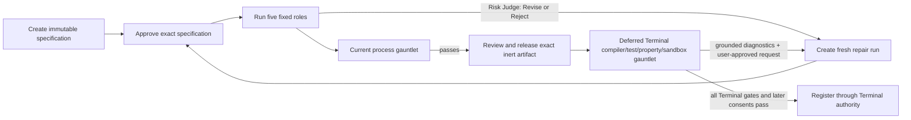

# Agentic gauntlet design

Status: Implemented workflow baseline plus explicitly deferred Terminal verification design

Date: 2026-08-08

Scope: Hyperion Free Strategy Workflow / Guided Agent Team

## 1. Decision

The default is a fixed five-role authoring pass, a deterministic process-integrity gauntlet, and at
most two generations of **fresh-run** repair per lineage chain. Model self-critique is advisory.
Deterministic external evidence is the acceptance authority.

The current free workflow deliberately does not run a compiler, tests, a backtest, a browser, or any
other model tool. It produces hash-bound inert C# source for human review. A future Terminal-owned
gauntlet may compile and test those exact bytes in a restricted environment, but that work is
deferred and must remain outside the model's authority.

The status words in this document are normative:

- **Implemented** means present in the current CLI/library contracts and covered by repository tests.
- **Proposed / deferred** means design direction only; it must not be represented as a current check.
- **Not guaranteed** identifies a claim that neither a model verdict nor a passing gauntlet proves.

## 2. Research comparison

| Loop | Useful mechanism | Reliability failure | Decision for this workflow |
|---|---|---|---|
| [ReAct](https://arxiv.org/abs/2210.03629) | Interleave reasoning, action, and environment observations. | A mistaken plan or observation can propagate; the agent can loop or drift through tools and context. | **Not implemented.** The model receives no tools. Hyperion, not the model, sequences provider calls and validations. |
| [Reflexion](https://arxiv.org/abs/2303.11366) | Convert evaluator feedback into verbal episodic memory for another trial. | A weak evaluator can create confident but false reflections; stale memory can poison later attempts. | **Partially analogous, not Reflexion.** Repairs receive exact parent artifacts and optional diagnostics, not self-authored persistent memory. |
| [Self-Refine](https://arxiv.org/abs/2303.17651) | Generate, self-critique, and revise with the same model. | Generator and critic share blind spots. Intrinsic correction can reduce reasoning accuracy without external feedback, as reported in [Large Language Models Cannot Self-Correct Reasoning Yet](https://arxiv.org/abs/2310.01798). | **Not an acceptance gate.** Critic and Risk Judge outputs help review, but cannot certify correctness. |
| [Language Agent Tree Search](https://arxiv.org/abs/2310.04406) and related tree search | Explore branches, score rollouts, reflect, and backtrack. | Higher inference cost, noisy model value estimates, branching growth, and an environment-reversion assumption. | **Not implemented and not the default.** Strategy generation is bounded and serial; no hidden candidate tree or model-scored rollout exists. |
| [Multiagent debate](https://arxiv.org/abs/2305.14325) | Independent arguments expose conflicting assumptions before a judge decides. | Agents can share correlated errors; a judge may prefer persuasive wording over truth; repeated rounds increase cost. | **Not implemented as debate.** Five prompts may use one provider/model, do not converse in rounds, and do not vote. |
| [CRITIC](https://arxiv.org/abs/2305.11738) | Ground critique in external tools, then amend the candidate. | Reliability still depends on tool coverage and faithful use of observations. | **Preferred future repair shape.** Terminal diagnostics may ground a new run, but the current workflow neither invokes nor controls the validator. |
| [Teaching Large Language Models to Self-Debug](https://arxiv.org/abs/2304.05128), [AlphaCodium](https://arxiv.org/abs/2401.08500), and [CodeT](https://arxiv.org/abs/2207.10397) | Use execution results or generated tests to select and repair code. | Visible or model-generated tests can share the candidate's blind spots and invite test overfitting. | **Diagnostics bridge implemented; execution deferred.** `workflow revise` can ingest diagnostics, but the free workflow does not create or execute them. |
| [EvalPlus](https://arxiv.org/abs/2305.01210) | Expand tests with generation and mutation to expose false passes. | Larger suites still prove only covered behavior; test and oracle defects remain possible. | **Design evidence for multiple independent gates.** A single compile or happy-path test must not become a semantic guarantee. |
| [OpenAI deep research](https://openai.com/index/introducing-deep-research/) and Anthropic's [multi-agent research system](https://www.anthropic.com/engineering/multi-agent-research-system) | Plan, search, pivot, parallelize independent investigations, and synthesize sources. | Source-quality, coordination, citation, state, and cost failures compound. Anthropic reports multi-agent research at roughly 15 times chat token use and notes that most coding tasks have fewer truly parallelizable subtasks. | **Not implemented.** The workflow uses only user-supplied sources, fixed roles, and no search or subagents. Deep research belongs before a separately approved source manifest, not inside code acceptance. |

## 3. Why deterministic gates and fresh-run repair are the default

1. **External observations break correlated self-judgment.** A parser, compiler, property runner, or
   sandbox can emit facts the generator did not invent. Self-critique alone cannot provide that
   independence.
2. **Code needs several oracles.** AlphaCodium's test-oriented flow improved its reported CodeContests
   validation result, while EvalPlus found substantial wrong-code false passes after expanding test
   coverage. Syntax, types, properties, and behavior therefore need distinct gates.
3. **Approval must follow bytes.** A silent in-place repair would make earlier approvals ambiguous. A
   new run binds the exact parent outputs, change request, diagnostics, provider profile, budgets, and
   replacement source under new hashes and approvals.
4. **Bounds are a security and product property.** Open-ended ReAct, debate, research, or tree search
   makes request count, cost, elapsed time, and disclosure difficult to predict. The fixed state
   machine has explicit terminal outcomes.
5. **The validator, not prose, decides.** Critic and Risk Judge reports can identify concerns, but a
   model cannot override a failed deterministic gate or claim that an unrun check passed.

The intended lifecycle is:

Only nodes through release, plus creation of a bounded repair run, are implemented by the free
workflow. The Terminal verification and registration nodes are deferred or owned elsewhere.

## 4. Implemented behavior

### 4.1 One coordinator, five fixed roles

This is one deterministic state machine making serial provider requests. "Agent team" is a user
experience label, not a claim that five autonomous programs, identities, or independent models are
running.

| Order | Role | Implemented instruction and authority |
|---:|---|---|
| 1 | Planner | Turn the request into a bounded strategy specification and identify missing requirements. |
| 2 | Evidence Analyst | Identify only supplied SDK, architecture, quantitative, and risk facts that constrain the source. |
| 3 | Critic | Challenge invented APIs, lookahead, unsafe order behavior, weak risk controls, and unverifiable assumptions. |
| 4 | Synthesizer | Emit one complete inert C# draft using safe relative `.cs` paths; do not claim compilation or execution. |
| 5 | Risk Judge | Review the exact proposed source as inert text and return exactly `Approve`, `Revise`, or `Reject`. |

Each successful role sees the immutable objective, escaped source content marked as untrusted data,
and all earlier validated role outputs. The prompt catalog is hash-bound to the run. The model is
given no browser, filesystem, shell, compiler, package, broker, order, or execution tool.

Role outputs are parsed as strict JSON with the expected role and schema. Citations must reference
known source IDs. Only the Synthesizer may return a strategy draft and only the Risk Judge may set a
decision. Draft validation enforces one to sixteen non-empty C# files, safe relative paths, at most
200,000 characters per file, and at most 1,000,000 aggregate characters. These are structural
controls, not C# parsing or semantic validation.

SQLite stores a versioned hash-chained run, while the content-addressed store holds role and strategy
artifacts. A successful Risk Judge approval creates `coordinator-strategy-source/v1` with:

- `deliveryState = inert-source/v1`;
- `requiresHumanRelease = true`;
- `requiresTerminalCompileConsent = true`;
- `installEligible = false`.

### 4.2 CLI lifecycle

The implemented CLI surface is `init`, `create`, `start`, `status`, `show`, `gauntlet`, `revise`, and
`release`.

1. `create` stores a new specification without a provider request and returns
   `AwaitingStartApproval` plus its SHA-256.
2. `start` requires an actor and the exact specification SHA-256. It records one start approval and
   runs or resumes the serial roles.
3. A Risk Judge decision transitions to `AwaitingReleaseApproval`, `NeedsRevision`, or `Rejected`.
4. `release` is accepted only in `AwaitingReleaseApproval` and must bind the exact final artifact
   SHA-256; it transitions the run to `Completed`.
5. Repeating the exact `start` command resumes an approved `Ready` or `Running` run. A still-live
   invocation is not duplicated. Once stale beyond request timeout plus 30 seconds, it is marked
   interrupted, its reserved budget is conservatively charged, and normal bounded retry may continue.
   Explicit operator cancellation is terminal and does not resume.

The local coordinator does not claim exactly-once external billing or dispatch across a host crash.
If the process dies after a provider accepted a request but before the result is durably recorded,
that attempt is ambiguous; stale recovery charges the reserved local budget before any bounded retry,
but a provider without a durable idempotency receipt may still have performed the first request.

### 4.3 Current deterministic gauntlet

`workflow gauntlet` is an inspection of durable process integrity. It runs no model and makes no
provider request. Its report schema is `hyperion-free-strategy-gauntlet-report/v1`, and it passes
only when all eight checks pass:

| Check ID | Implemented assertion |
|---|---|
| `verified-event-chain-and-profile` | The durable event chain loads successfully and the run uses the exact free strategy policy/workflow profile. Integrity failures fail closed before a report is returned. |
| `exact-start-approval` | Exactly one start approval binds the current specification SHA-256 and no artifact. |
| `complete-role-artifacts` | Exactly one validated artifact exists for each of the five roles. |
| `risk-judge-approval` | The exact Risk Judge artifact says `Approve`. |
| `strategy-artifact-lineage` | The final strategy artifact hash and contents reproduce from the exact run, Synthesizer artifact, Risk Judge artifact, and evidence IDs. |
| `inert-authority-boundary` | The artifact requires human release and Terminal compile consent, is not install-eligible, and carries the inert delivery state. |
| `release-review-state` | The run is awaiting exact human release review or is already completed. |
| `release-approval-consistency` | An awaiting run has no release approval; a completed run has exactly one release approval bound to its specification and final artifact. |

`ProcessIntegrityPassed` is the conjunction of those checks. `ReadyForHumanReleaseReview` is true
only when process integrity passes and the state is `AwaitingReleaseApproval`. The report always sets:

- `SemanticCorrectnessGuaranteed = false`;
- `CompilationVerification = "not-run-by-free-workflow"`;
- `FunctionalVerification = "not-run-by-free-workflow"`.

The CLI exits `0` for a passing process gauntlet and `2` otherwise.

### 4.4 Current fresh-run revision

`workflow revise` is not an in-place patch and is not a hidden self-refinement loop.

- The parent must be `NeedsRevision`, `Rejected`, `AwaitingReleaseApproval`, or `Completed`.
- The configured provider descriptor must exactly match the parent provider, model, protocol,
  endpoint, prices, and credential binding.
- Hyperion reads exactly one verified parent Synthesizer output and Risk Judge output.
- Every loaded repair run recursively verifies the actual parent event chain, status, specification
  hash, provider, inherited evidence, role artifacts, decision, final artifact, root objective, and
  round depth. Internally consistent but fictitious repair sources fail closed.
- It preserves the original non-repair sources and root objective.
- It adds hash-bound repair lineage, exact serialized parent draft/review, a required user-approved
  change request, and optional user- or Terminal-supplied diagnostics.
- The new objective requires one complete replacement strategy, not a patch.
- It creates a new run ID in `AwaitingStartApproval` with no inherited approvals. All five roles run
  again only after fresh start approval; any approved result requires fresh release approval.
- A repair lineage may have depth at most two. A third-generation repair is rejected. The current
  store does not enforce one child per parent, so separate sibling repair runs may still be created.
- Initial runs accept at most 58 user sources, reserving six source slots for repair lineage. A
  revision is created only when its inherited evidence, exact parent outputs, request, and optional
  diagnostics still fit the per-source and aggregate context limits; otherwise it fails before
  creating partial lineage.

The per-lineage depth cap is fixed. Each new run receives its own configured run budget; there is no
implemented aggregate cost cap across a root and its repair descendants or siblings.

### 4.5 Stop conditions and limits

The default run budget is:

| Limit | Default | First-slice validator ceiling |
|---|---:|---:|
| Provider requests | 10 | 1,000 |
| Attempts per role | 2 | 20 |
| Prompt tokens | 500,000 | 10,000,000 |
| Output tokens | 40,000 | 10,000,000 |
| Output tokens per request | 8,000 | 1,000,000 |
| Declared cost | USD 5 | USD 1,000,000 |
| Response bytes | 1,000,000 | 100,000,000 |
| Artifact bytes | 2,000,000 | 100,000,000 |
| Run elapsed time | 900 seconds | 86,400 seconds |
| Request timeout | 120 seconds | 3,600 seconds |
| Repair rounds | 2 | 2, fixed |

The CLI-generated config uses the defaults, but a reviewed config may change run-budget values within
the validator ceilings. Preflight token accounting uses UTF-8 bytes as a conservative
tokenizer-independent estimate and charges the larger of that estimate and valid reported usage.

An implemented run stops or leaves the execution loop when:

- a role exhausts its configured attempt count (`Failed`);
- the provider reports a non-retryable failure, a truncated/non-`stop` completion, or another invalid
  terminal response (`Failed`);
- a retryable provider failure or structurally invalid role output consumes the remaining attempts;
- a preflight or postflight request, token, byte, artifact, elapsed-time, or declared-cost bound is
  reached (`BudgetExhausted`);
- the operator cancellation token interrupts an active invocation (`Cancelled`);
- the Risk Judge returns `Revise`, `Reject`, or `Approve` (`NeedsRevision`, `Rejected`, or
  `AwaitingReleaseApproval` respectively);
- exact release approval completes the run (`Completed`).

There is no implemented diagnostic-fingerprint or "no improvement" detector. The fixed attempt and
repair-round caps are the current loop bounds.

## 5. Implemented BYOK profile security model

The CLI v2 configuration selects a named profile rather than permitting every field to vary freely.

- `mock` is network-free. `ollama` pins loopback OpenAI-compatible HTTP at
  `http://127.0.0.1:11434/v1` and needs no key by default.
- `openai`, `openrouter`, `groq`, `mistral`, and `deepseek` pin their canonical HTTPS origin,
  OpenAI-compatible protocol, provider ID, and dedicated `DAXALGO_LLM_*` credential slot.
- The `openai` profile is specifically the constrained Chat Completions compatibility adapter. It
  rejects o-series model IDs because OpenAI documents `max_tokens` as incompatible with those
  models; a native OpenAI Responses profile is deferred.
- `anthropic` and `gemini` pin their official HTTPS origin, native protocol, provider ID, native
  authentication adapter, and dedicated credential slot.
- `custom-openai-compatible` is the only CLI profile that can override provider ID and endpoint. A
  remote custom endpoint requires both provider-egress and custom-provider opt-in. Its credential
  slot includes the full SHA-256 of the canonical origin, preventing one custom-origin config from
  naming another origin's slot.

Remote providers require explicit egress consent in the config and positive declared input/output
prices. Endpoints must be absolute HTTPS URIs, except HTTP loopback; user information, query strings,
and fragments are rejected. The CLI HTTP client disables redirects, cookies, ambient credentials,
automatic decompression, and proxies.

The credential value is resolved from the named environment variable only when `start` needs a live
provider. Empty, surrounding-whitespace, CR, or LF values are rejected. The secret value is never
written to the config, run, workspace, artifacts, or CLI output. The nonsecret credential-slot name
is part of the live provider descriptor and therefore part of the approved run binding. Resume and
repair reject a mismatched provider descriptor. A successful HTTP payload that echoes the exact
configured credential in persisted completion text or provider request identity is rejected before
the provider result reaches durable workflow state.

The in-process `external-adapter/v1` route is different: the embedding Terminal owns its endpoint,
authentication, credential store, redaction, and egress consent. Endpoint and credential fields are
forbidden in that run descriptor.

This is a bounded credential-and-origin routing model, not a declaration that a selected provider is
trustworthy. The current standalone CLI uses environment variables rather than an OS credential
store, has a config-level rather than run-bound egress receipt, and does not claim full DNS-rebinding
or custom-private-network isolation. A production Terminal integration remains responsible for a
trusted app-owned profile store, OS-backed secrets, a run-bound egress/rights receipt, provider
capability fingerprinting, workspace hardening, and safe retention/deletion.

## 6. Honest guarantee boundary

| A passing current gauntlet establishes | It does **not** establish |
|---|---|
| Exact policy, workflow, prompt-catalog, provider, budget, and specification lineage | That provider or model output is truthful, independent, or high quality |
| Complete structurally valid role artifacts and an approving Risk Judge output | That the Risk Judge is a formal verifier or that debate occurred |
| Exact reproducibility of the inert strategy artifact from its approved lineage | Successful parsing, compilation, linking, loading, or execution |
| Bounded workflow authority and no install eligibility | Absence of unsafe logic, invented APIs, lookahead, leakage, numerical defects, or excessive risk |
| Human start/release approvals bound to exact hashes | Profitability, robustness, suitability, regulatory compliance, or live-trading safety |

Human release means "these exact inert bytes may be handed to the next review stage." It does not
mean "safe to install," "safe to trade," or "verified strategy." Terminal compile consent,
registration consent, and any later execution authority remain separate.

The workflow's no-tools contract means Hyperion grants the model no execution authority. It cannot
prove that an independently operated model daemon or remote provider performs no outside activity;
the user and embedding application own that trust decision.

## 7. Proposed/deferred Terminal-owned verification gauntlet

This section is **not implemented by `workflow gauntlet`**. It is the desired downstream design for
the buildable private Terminal consumer after human release/import and before registration.

| Deferred gate | Terminal-owned evidence | Failure disposition |
|---|---|---|
| 1. Exact intake | Recompute the released artifact, file, compiler-profile, SDK/context-pack, and source-manifest hashes. | Reject any drift; do not compile changed bytes. |
| 2. Parse and restricted compile | Use the pinned Terminal compiler/toolchain with no package restore, network, broker, or model authority. Capture normalized diagnostics and toolchain identity. | Hard fail. Diagnostics may seed a new approved repair run. |
| 3. Deterministic functional tests | Run versioned golden and request-derived tests for lifecycle, state, signals, order intent, sizing, exits, and risk controls. | Hard fail; never let a model waive a failed assertion. |
| 4. Property and metamorphic tests | Check determinism, bounded outputs, causality/no future-bar access, missing/NaN/extreme inputs, position/risk invariants, and time/data transformations with declared expected relations. | Hard fail or mark the exact property suite inconclusive; no semantic pass on inconclusive evidence. |
| 5. Restricted sandbox behavior | Execute only in a resource-bounded, networkless, brokerless sandbox against frozen fixtures. Record CPU, memory, time, exceptions, prohibited access, and deterministic trace hashes. | Terminate on authority/resource violation; produce bounded safe diagnostics. |
| 6. Human diff and registration | Show source, diagnostics, test/property results, residual risks, and exact hashes before existing registration consent. | No registration without the separate Terminal authority gate. |

The Terminal should emit a bounded, machine-readable diagnostic bundle containing the parent artifact
hash, compiler/test/property/sandbox profile versions, fixture hashes, stable diagnostic IDs,
locations, and safe messages. After explicit user review, that bundle can be supplied to
`workflow revise --diagnostics`. The model proposes a complete replacement; the Terminal reruns all
applicable gates from clean state.

The current two-generation repair-depth cap remains the per-lineage outer bound. The deferred verifier
should additionally stop on a repeated diagnostic fingerprint, no reduction in hard failures,
nondeterministic/flaky evidence, profile drift, a security/authority violation, budget exhaustion, or
user cancellation. It must not silently broaden tests, modify source, inherit approval, or choose a
"best failing" candidate for registration.

Even this future gauntlet would provide scoped evidence for the exact artifact, toolchain, fixtures,
and profiles tested. It would not prove profitability or all possible behavior. Synthetic fixtures
are workflow-verification evidence, not trading-quality or model-training evidence.

## 8. Implementation anchors

- [CLI commands and disclosures](../../../src/windows/Tools/Hyperion.Cli/FreeStrategyWorkflowCli.cs)
- [CLI provider profiles](../../../src/windows/Tools/Hyperion.Cli/FreeStrategyWorkflowCliConfig.cs)
- [CLI provider runtime](../../../src/windows/Tools/Hyperion.Cli/FreeStrategyWorkflowCliRuntime.cs)
- [Free workflow runner and gauntlet](../../../src/windows/AI/Hyperion.FreeStrategyWorkflow/FreeStrategyWorkflowRunner.cs)
- [Free workflow contracts and defaults](../../../src/windows/AI/Hyperion.FreeStrategyWorkflow/FreeStrategyWorkflowContracts.cs)
- [Five-role prompt catalog](../../../src/windows/AI/TradingTerminal.Ai.Coordinator/Orchestration/CoordinatorPromptCatalog.cs)
- [Coordinator state machine](../../../src/windows/AI/TradingTerminal.Ai.Coordinator/Orchestration/ResearchCoordinator.cs)
- [Strategy artifact validation](../../../src/windows/AI/TradingTerminal.Ai.Coordinator.Contracts/Contracts/CoordinatorStrategyArtifacts.cs)
- [Workflow tests](../../../tests/TradingTerminal.Tests.Pro.Headless/Coordinator/FreeStrategyWorkflowTests.cs)
- [Terminal integration plan](terminal-integration-plan.md)

## 9. Primary sources

- Yao et al., [ReAct: Synergizing Reasoning and Acting in Language Models](https://arxiv.org/abs/2210.03629).
- Shinn et al., [Reflexion: Language Agents with Verbal Reinforcement Learning](https://arxiv.org/abs/2303.11366).
- Madaan et al., [Self-Refine: Iterative Refinement with Self-Feedback](https://arxiv.org/abs/2303.17651).
- Yao et al., [Language Agent Tree Search Unifies Reasoning Acting and Planning in Language Models](https://arxiv.org/abs/2310.04406).
- Du et al., [Improving Factuality and Reasoning in Language Models through Multiagent Debate](https://arxiv.org/abs/2305.14325).
- Gou et al., [CRITIC: Large Language Models Can Self-Correct with Tool-Interactive Critiquing](https://arxiv.org/abs/2305.11738).
- Chen et al., [Teaching Large Language Models to Self-Debug](https://arxiv.org/abs/2304.05128).
- Ridnik et al., [Code Generation with AlphaCodium: From Prompt Engineering to Flow Engineering](https://arxiv.org/abs/2401.08500).
- Chen et al., [CodeT: Code Generation with Generated Tests](https://arxiv.org/abs/2207.10397).
- Liu et al., [Is Your Code Generated by ChatGPT Really Correct? Rigorous Evaluation of Large Language Models for Code Generation](https://arxiv.org/abs/2305.01210).
- Huang et al., [Large Language Models Cannot Self-Correct Reasoning Yet](https://arxiv.org/abs/2310.01798).
- OpenAI, [Introducing deep research](https://openai.com/index/introducing-deep-research/).
- Anthropic, [How we built our multi-agent research system](https://www.anthropic.com/engineering/multi-agent-research-system).
- OpenAI, [Create chat completion](https://developers.openai.com/api/reference/resources/chat/subresources/completions/methods/create).
