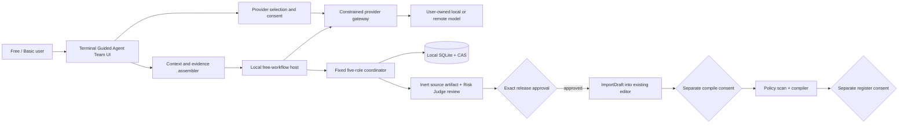
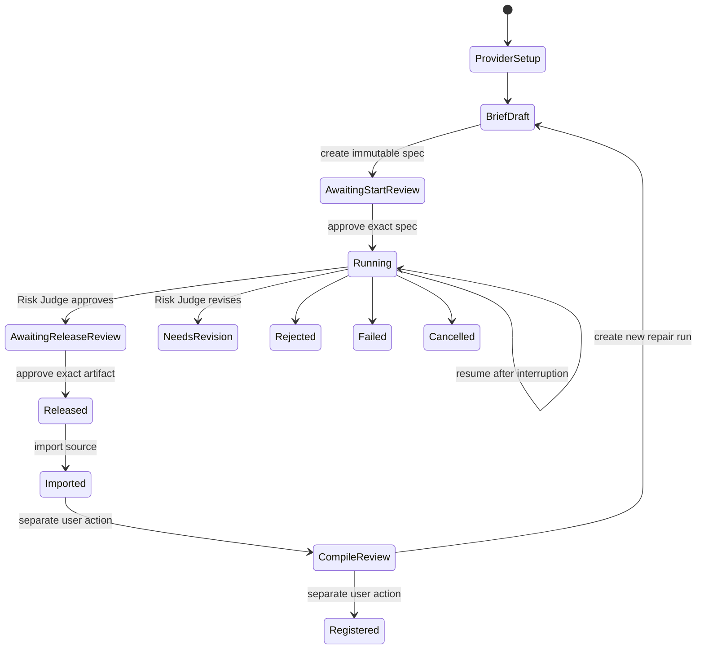

# Free-user AI agentic strategy workflow

Status: Draft for product approval

Date: 2026-08-06

Scope: Local/BYOK strategy authoring for the free/Basic Terminal experience

## 1. Product outcome

Give a free Terminal user a guided team of AI roles that can turn a bounded strategy brief and
approved context into reviewable C# source using a model the user already controls. Hyperion charges
no workflow credits. The selected provider may still charge the user.

The workflow guarantees process integrity, bounded authority, provenance, recovery, and exact human
approvals. It does **not** guarantee profitability, safety, model quality, successful compilation, or
HTT-level accuracy and efficiency.

The recommended product name is **Guided Agent Team** with the subtitle **Free · use your own AI**.

## 2. Product modes

The Terminal should present three clearly different authoring modes rather than treating every path
as another model provider.

| Mode | Intended experience | Runtime behavior | Availability |
|---|---|---|---|
| Direct AI chat | Fast iterative conversation and code editing | Existing provider conversation, compile/auto-fix support, then explicit registration | Existing free/Basic experience |
| Guided Agent Team | Governed Planner → Evidence Analyst → Critic → Synthesizer → Risk Judge workflow | Local/BYOK, two exact approvals, inert source only, no compile inside the workflow | Proposed default guided free experience |
| Hyperion / HTT | Hyperion-managed narrow-model experience | Future signed model/profile, governed retrieval and evaluation | Separate future/paid product |

Guided Agent Team should not call the hosted Hyperion API, consume hosted credits, or weaken hosted
Professional authorization.

## 3. User journey

### 3.1 Choose the mode and provider

The user opens Strategy Builder and selects **Guided Agent Team**. The Terminal shows all eligible
providers with explicit labels:

- **Loopback connection** for a model such as Ollama, with a warning that the model daemon controls
  any further network activity;
- **Sends data to provider** for a remote API;
- **External charges may apply** when Hyperion does not own billing;
- **Unavailable** with setup guidance when a key, model, or local runtime is missing.

The provider secret remains in the Terminal credential store or vendor-owned login. It never enters
the run specification, SQLite workspace, artifact store, log, or telemetry.

### 3.2 Build the brief and evidence set

The first screen uses structured fields plus an advanced free-text section:

- objective and strategy family;
- instruments and market-data assumptions;
- timeframe and session rules;
- entry and exit behavior;
- sizing and hard risk limits;
- prohibited behavior and evidence requirements;
- optional user-supplied context files.

A deterministic completeness check highlights missing instrument, timeframe, sizing, stop, or exit
information. It does not call a model and does not invent defaults.

The Terminal assembles a visible evidence manifest from the exact installed strategy context pack,
at most the bounded relevant skill packs, the compiler/API profile, and user-selected sources. The
user sees every source name, category, size, rights declaration, and hash before provider dispatch.

### 3.3 Review provider egress and the immutable specification

Creating the specification performs no provider request. Before start, the user reviews:

- provider and model identity;
- whether content leaves the device;
- the exact evidence manifest;
- request, token, byte, time, and declared-cost ceilings;
- the external-cost disclaimer;
- local plaintext-storage and retention behavior;
- the specification SHA-256.

A remote start requires an egress receipt bound to the exact specification hash. The receipt states
which provider receives the brief, sources, and earlier role outputs. Consent must be renewed when
the provider profile, model, source set, or material data policy changes.

### 3.4 Run the five-role workflow

The user explicitly approves Start. The UI presents a recoverable stepper:

1. Planner;
2. Evidence Analyst;
3. Critic;
4. Synthesizer;
5. Risk Judge.

Each role shows pending/running/completed/retrying/failed state, elapsed time, bounded usage, and a
safe summary. Raw validated role output is expandable for expert review. Stop is always available.
Restarting the Terminal resumes the same approved run without duplicating approval or dispatch.

### 3.5 Review and release source

If the Risk Judge approves, the Terminal shows:

- every generated file and file hash;
- the Risk Judge summary, risks, and recommendations;
- evidence-source citations;
- the exact final artifact hash;
- a permanent **INERT SOURCE ONLY** warning.

The user separately approves Release for those exact bytes. A changed artifact, risk output, source
identity, or run profile invalidates release.

### 3.6 Import, compile, and register

Release enables **Import to editor**. The artifact is mapped to the existing `StrategyScript` import
seam. Import creates editable source but never compiles, installs, registers, backtests, connects to a
broker, or places an order.

The existing editor remains authoritative for:

1. explicit Compile consent;
2. policy scan and compiler diagnostics;
3. code/diff review;
4. separate Register consent.

Any edit after import is visibly outside the released hash. A compiler error can be fixed manually or
used to create a **new** lineage-linked repair run. Earlier approvals never transfer to repaired bytes.

## 4. Target architecture

The model sees only bounded prompt messages. It receives no browser, filesystem, shell, compiler,
package, process, broker, order, or execution tool from Hyperion.

## 5. Component responsibilities

| Component | Responsibility | Repository boundary |
|---|---|---|
| Guided Agent Team UI | Brief, provider readiness, evidence, approvals, progress, source/risk review, import | Downstream buildable Terminal shell; only reference sources are present here |
| Context/evidence assembler | Convert installed context pack, selected skills, compiler profile, and user files into strict sources | Private Terminal integration; consume public contracts read-only |
| Local workflow host | Run listing, one-active-run policy, background execution, progress, cancellation, resume, retention/deletion | Extend `Hyperion.FreeStrategyWorkflow` |
| Provider gateway | Create a text-only `ILlmProvider`, resolve secrets, enforce capability profile and egress receipt | Private integration layer |
| Five-role coordinator | Strict prompts, output parsing, budgets, hash chain, approvals, inert artifact | Existing private Hyperion coordinator |
| Workspace | App-local SQLite/CAS storage with no credentials | Existing workspace plus retention/index APIs |
| Editor handoff | Map exact released files to `StrategyScript` and call `ImportDraft` | Existing downstream Terminal seam |
| Compiler/registry | Scan, compile, diff review, register only after separate consent | Existing Terminal authoring path; outside this workflow |

## 6. State model

Only states through `Released` belong to the free workflow. Compile, registration, backtest, and
execution states remain owned by the existing Terminal authoring system.

## 7. Context and evidence contract

The first Terminal integration should provide these source categories:

1. exact installed strategy SDK/context pack;
2. deterministically selected relevant skills, within the existing count and character ceilings;
3. compiler profile and supported artifact shape;
4. user brief and user-approved reference files;
5. optional risk policy selected by the user or product edition.

Each source needs a stable ASCII ID, title, content, category, origin, rights assertion, retrieval or
build time, and SHA-256. Sources are untrusted evidence, not instructions. Prompt rendering must keep
the fixed role instructions authoritative and reject citations to unknown source IDs.

The workflow must not silently load the whole project, current working directory, chat history,
secrets, account data, or market data. Every uploaded byte category must be visible before remote
egress.

Repair is a separate versioned contract. A repair run may receive the exact released parent artifact,
compiler profile, bounded diagnostics, and a user change request. It records parent lineage and
requires fresh start/release approvals.

The CLI foundation now implements this as a bounded loop: inspect the deterministic process
gauntlet, create a new lineage-bound repair run, and repeat for at most two repair rounds. It carries
the exact parent Synthesizer and Risk Judge outputs plus the approved change request and optional
diagnostics; it never transfers approvals. This is deliberately not an unbounded ReAct, debate, or
tree-search loop. The research comparison and future Terminal-owned verification gates are recorded
in [Agentic gauntlet design](agentic-gauntlet-design.md).

## 8. Provider eligibility

| Provider route | Current CLI / proposed product | Requirements |
|---|---|---|
| Deterministic mock | Development | Network-free lifecycle and UI rehearsal only |
| Ollama loopback OpenAI-compatible server | CLI implemented; v1 default | Loopback validation, bounded response, no key or proxy; disclose that daemon networking is outside Hyperion |
| Pinned remote OpenAI-compatible BYOK | CLI implemented; v1 opt-in | Fixed OpenAI, OpenRouter, Groq, Mistral, or DeepSeek origin and secret slot; HTTPS, explicit egress consent, positive declared prices, redirects/proxy disabled; OpenAI o-series needs a future native Responses profile |
| Custom remote OpenAI-compatible BYOK | CLI implemented; expert opt-in | Explicit custom-provider consent and a slot containing the canonical origin's full SHA-256 |
| Native Anthropic Messages | CLI implemented; product qualification pending | Fixed official origin, dedicated `x-api-key` adapter, strict response/usage parsing, no tools |
| Native Google Gemini `generateContent` | CLI implemented; product qualification pending | Fixed official origin, dedicated `x-goog-api-key` adapter, strict response/usage parsing, no tools |
| Installed Claude/Codex-style agent CLI | v2 only | Tool-free profile, empty private working directory, environment allowlist, no shell, bounded stdin/stdout/stderr, timeout and kill-tree, capability tests |
| Hosted HTT/Hyperion | Separate product | Signed model/profile, hosted entitlement/credits, governed evaluation and retrieval |

The existing direct-codegen `IStrategyCodegenClient` contract must not be wired blindly into the
five-role workflow. Its session path compiles/auto-fixes, and installed-CLI adapters may append a
C#-specific output contract or expose vendor tools. The integration needs a text-only provider bridge
that maps raw role JSON, usage, safe failures, cancellation, and bounded bytes into `LlmCallResult`.

Every eligible provider profile should bind a nonsecret fingerprint covering adapter version,
provider/model, reasoning/sampling profile, structured-output behavior, usage semantics, endpoint
class, tool authority, and the adapter implementation or executable identity. A changed fingerprint
cannot resume an approved run. Endpoint URLs and secret values need not be exposed in the run when a
privacy-preserving fingerprint is used. External delegates must honor cancellation; a cooperative
timeout alone is not a process-isolation boundary.

## 9. Free-tier limits and disclosures

The recommended v1 defaults retain the implemented ceilings:

- one active guided workflow per Terminal by default;
- at most 58 initial user sources, reserving six of the 64 source slots for repair lineage;
- at most 10 provider requests and two attempts per role;
- at most two fresh lineage-bound repair runs, with new approvals on every run;
- at most 500,000 conservative prompt units and 40,000 output units;
- at most 8,000 output units per request;
- 1 MB response and 2 MB artifact ceilings;
- 15-minute run and 2-minute request ceilings;
- a declared USD guard, clearly distinguished from the provider's authoritative bill.

“Free” means no Hyperion workflow charge or Professional AI entitlement for this local path. It does
not mean the chosen provider, electricity, local hardware, or vendor subscription is free.

Provider-native spending limits remain recommended. If exact pricing is unavailable, the UI says
**external cost unknown** rather than showing zero.

## 10. Storage, privacy, and rights

- Store workspaces under a private app-local directory, never a repository or shared project folder.
- Create config/workspaces atomically with a versioned marker, reject reparse/symlink traversal, keep
  every resolved CAS path under the approved root, and apply private-user filesystem permissions.
- Store no provider secret or raw authentication material in the workspace.
- Disclose that briefs, sources, role outputs, approvals, and generated source are plaintext locally.
- Offer run history, export, user-confirmed deletion, and a configurable retention policy.
- Treat remote egress consent separately from permission to upload; require a user rights assertion.
- Exclude runs from training and evaluation by default. Any reuse needs separate granular opt-in,
  lineage, redaction, revocation, and deletion handling.
- Local product telemetry is off by default. When enabled it is content-free.
- Never log prompts, source text, generated code, secrets, full endpoints, or customer-content hashes.

## 11. UI information architecture

The proposed Guided Agent Team surface has six sections:

1. **Provider** — readiness, model, local/remote badge, external-cost and data-policy disclosure;
2. **Brief** — structured strategy/risk fields and optional context files;
3. **Review start** — exact source manifest, budgets, provider fingerprint, egress receipt, spec hash;
4. **Agent team** — role stepper, safe progress, usage, stop, retry/resume;
5. **Review source** — files, Risk Judge findings, citations, artifact hash, release action;
6. **Editor handoff** — import only, followed by the existing Compile and Register gates.

The normal view shows concise role summaries. Raw validated JSON, hashes, and budgets remain available
under expert expanders. The workflow never uses chat wording that suggests five autonomous programs;
it is one deterministic state machine making bounded provider calls under five role prompts.

## 12. Required Hyperion API additions before Terminal UI work

The current runner is sufficient for CLI use but a desktop host needs:

- list and query local runs without reconstructing internal storage;
- cancellable background execution and observable state transitions;
- safe role-output summaries and an authenticated Risk Judge review accessor;
- one-active-run coordination and idempotent resume;
- retention, delete, and export operations with exact target validation;
- a versioned provider-capability/profile fingerprint;
- a run-bound remote-egress/rights receipt;
- an allowlisted app-local workspace factory with marker, atomic creation, reparse-point defense,
  private permissions, and safe purge/export targets;
- metadata-only default CLI output, with explicit review/export commands for source-bearing content;
- loopback HTTP configured without proxy use and explicit consent for private-network/remote routes.

These additions belong in private Hyperion projects and tests. They must not be placed in `public/`.

## 13. Evaluation and qualification

Workflow conformance applies to every adapter. A quality badge applies only to an exact provider,
model revision, prompt catalog, capability fingerprint, budget, and sampling profile.

Proposed pilot gates, to be frozen only after a measured baseline:

- 100% rejection of wrong profile, hash, source identity, approval, provider binding, path, or
  execution-authority flags;
- zero successful tool/filesystem/process/compiler/broker/order escapes across at least 1,000
  adversarial cases;
- at least 99% structurally valid role outputs after allowed retry and 98% complete five-role runs;
- at least 90% restricted compile pass@1 and 85% functional-test pass@1 for a qualified-model badge;
- zero critical unsafe Risk Judge approvals in at least 1,000 malicious cases, with uncertainty
  reported rather than only the observed count;
- 100% retry/restart idempotency for local approvals and committed state; ambiguous post-dispatch
  crashes are conservatively accounted and exactly-once provider dispatch is claimed only when a
  provider-backed idempotency receipt proves it;
- at least 80% human-review acceptance and median review time under 10 minutes in the pilot;
- zero privacy-canary matches in logs and telemetry.

The sealed suite must cover SDK correctness, invented APIs, statefulness, lookahead, numerical and
risk constraints, prompt injection, hostile sources, malformed/truncated providers, cancellation,
restart, profile drift, and hash swapping. Synthetic fixtures remain workflow evidence, not trading
quality or model-training evidence.

## 14. Telemetry

With explicit local opt-in, record only version IDs, route class, reason codes, state transitions,
latency buckets, byte/token counts, retry counts, budget utilization, and compile outcome. Never record
the brief, prompt, source, code, provider secret, full endpoint, or content-derived fingerprint.

The UI should work fully with telemetry disabled. Operational alerts for a future hosted product are
separate and must not be used to justify silently uploading local free-workflow content.

## 15. Delivery roadmap

### Phase 0 — Product approval

- approve the mode name, v1 provider set, retention default, and visible role detail;
- confirm that free means local/BYOK, not a hosted zero-credit bypass;
- freeze the strategy-only v1 scope.

### Phase 1 — Buildable Hyperion integration contract

- add desktop-host lifecycle APIs, progress, cancellation, Risk Judge access, retention, and tests;
- add provider capability/fingerprint and run-bound egress/rights receipt contracts;
- add a text-only adapter conformance harness;
- harden workspace/config creation, CAS path handling, local HTTP routing, and source-bearing CLI output;
- keep the existing CLI as the diagnostic and accessibility fallback.

### Phase 2 — Terminal Guided Agent Team

- implement provider/context adapters in the actual buildable private Terminal consumer;
- add the Guided Agent Team view model/view, DI registration, navigation, recovery, and history;
- map released artifacts to the existing `ImportDraft` seam;
- verify Compile and Register remain separate explicit actions.

This standalone repository cannot complete Phase 2 today because its private Terminal shell files are
reference sources without a buildable project. `public/` remains read-only.

### Phase 3 — Provider pilot and qualification

- exercise the implemented loopback, pinned remote, native Anthropic, and native Gemini CLI profiles
  behind explicit consent;
- run adapter conformance, sealed safety/quality suites, privacy canaries, and user review studies;
- publish exact-profile qualification badges and honest unqualified-provider warnings.

### Phase 4 — Remaining adapters and Terminal verification gauntlet

- add hardened installed-agent-CLI profiles only through a separate named-adapter provider host after
  no-tools/process-isolation acceptance. Require an absolute executable identity, fixed arguments,
  sanitized environment, isolated working/home directories, bounded framed output, no shell, and
  hard process-tree termination;
- connect the implemented new-run revision lineage to separately consented Terminal compiler
  diagnostics;
- add deterministic parse, compiler, policy, property, and sandbox-test gates outside the free
  model-calling workflow.

### Phase 5 — Later products

- visualizer artifact contract and verifier;
- HTT-backed guided workflow;
- any separately designed hosted included allowance.

## 16. v1 acceptance criteria

The v1 free-user feature is ready only when:

1. a free/Basic user can finish the full loopback or BYOK journey without hosted credits;
2. the exact source/evidence set and egress destination are reviewable before provider dispatch;
3. provider/model/profile drift is rejected before any approval mutation or model call;
4. stop, crash, restart, retry, and app relaunch preserve one hash-bound run;
5. every role output and final artifact is strictly parsed, bounded, stored, and lineage-verified;
6. source cannot be imported before exact human release;
7. import cannot compile, register, install, backtest, execute, or trade;
8. Compile and Register remain separate existing user-consent gates;
9. no provider secret or user content appears in config, logs, telemetry, or error messages;
10. the selected provider profile passes the conformance suite and the workflow passes the security
    gates above;
11. `public/` remains unchanged and hosted entitlement/credit behavior remains unchanged;
12. limitations, external charges, plaintext storage, retention, and unqualified-model quality are
    visible in-product.

## 17. Decisions for approval

Recommended defaults:

| Decision | Recommendation |
|---|---|
| Product label | **Guided Agent Team · Free · use your own AI** |
| v1 providers | Ollama plus pinned OpenAI, OpenRouter, Groq, Mistral, DeepSeek, Anthropic, and Gemini profiles; mock for rehearsal; qualification still required |
| Custom endpoint | Expert opt-in only, with explicit consent and an origin-bound credential slot |
| Installed agent CLIs | Defer to v2 until tool-free process isolation is proven |
| Concurrency | One active guided workflow per Terminal, with queued/new runs blocked clearly |
| Repair | Always a new lineage-linked run with fresh approvals |
| Role visibility | Summaries by default; validated raw output available in expert details |
| Local retention | User-selectable; present a privacy-oriented default during implementation review |
| Telemetry | Off by default and content-free when enabled |
| Hosted free inference | Out of scope; do not weaken hosted Professional/credit controls |

Approval of these defaults authorizes Phase 1 planning refinement, not production deployment.
